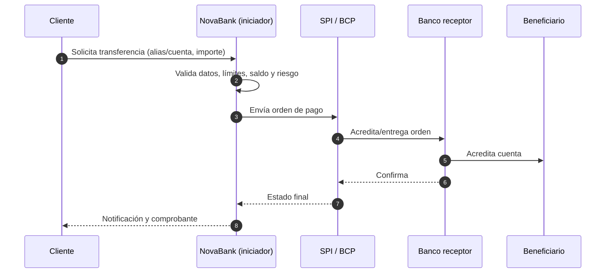
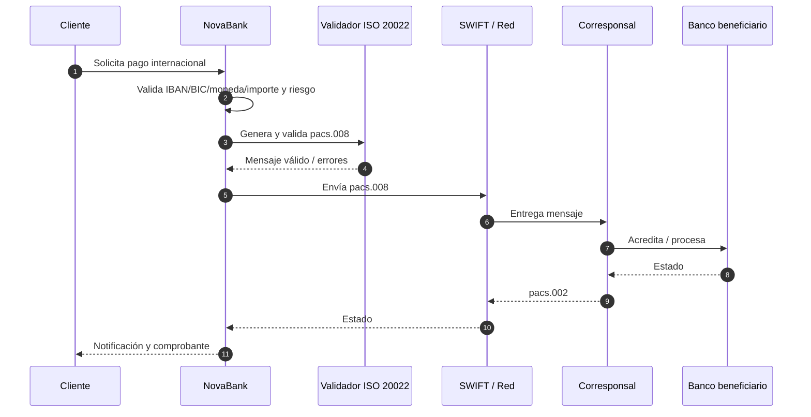
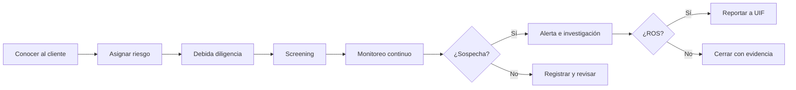

# Contexto regulatorio y estándares

**Proyecto:** NovaBank Instant & Cross-Border Payments + AML Hub
**Documento:** REG-NB-001
**Versión:** 1.0
**Fecha:** 2026-10-27
**Autor:** Franco Tillería Centurión — Business Analyst

> Documento de contexto para diseño funcional. **No es asesoría legal ni certificación de cumplimiento.** Las normas y estándares se citan desde fuentes públicas registradas en `docs/FUENTES.md`; la aplicación concreta al perímetro de NovaBank debe validarla Cumplimiento y Legal.

---

## 1. Propósito

Explicar el marco normativo y los estándares que condicionan el diseño de pagos instantáneos, pagos internacionales y AML en el caso NovaBank, y traducirlos en controles funcionales verificables.

---

## 2. Mapa de actores regulatorios

| Actor | Rol en el caso | Interacción con NovaBank |
|---|---|---|
| Banco Central del Paraguay (BCP) | Autoridad monetaria y regulador del sistema de pagos; opera el SIPAP. | Reglas del SPI/SIPAP, participación, disponibilidad, límites y reporte. |
| Superintendencia de Bancos (SIB) | Supervisión de entidades financieras, dentro del BCP. | Supervisión prudencial y de cumplimiento. |
| SEPRELAD | Unidad de Inteligencia Financiera (UIF) de Paraguay. | Recepción de ROS, supervisión AML/CFT, lineamientos y resoluciones. |
| GAFI / FATF | Emisor de estándares internacionales AML/CFT. | Referencia para debida diligencia, transferencias y reporte. |
| SWIFT | Proveedor de mensajería y autoridad de registro de IBAN. | Mensajería ISO 20022/MT y formatos de cuenta. |
| ISO | Emisor de estándares (ISO 20022, ISO 4217, ISO 13616). | Semántica de mensajes, monedas e IBAN. |
| Banco corresponsal | Contraparte internacional (ficticia). | Procesamiento, rechazos, devoluciones y screening. |
| Auditoría interna | Aseguramiento independiente. | Diseño y efectividad de controles. |

---

## 3. Pagos instantáneos: SPI del BCP

### 3.1 Características relevantes

Según la información pública del BCP [F-01, F-02]:

| Característica | Descripción | Implicancia de diseño |
|---|---|---|
| Operación | 24/7, incluso feriados (F-01). | El canal y la operación deben soportar disponibilidad continua. |
| Moneda | Guaraníes (PYG). | Validación ISO 4217 y formateo local. |
| Límite | Hasta ₲10.000.000 por operación. | Validación de importe y mensajes de error claros. |
| Acreditación | Hasta 5 segundos (F-01). | SLA del motor y de la integración. |
| Identificación | Alias (CAS) o cuenta. | Resolución de alias y verificación de titular. |
| Irrevocabilidad | La transferencia es irrevocable, salvo procesos especiales. | Confirmación previa clara y control de fraude. |
| Devoluciones | Solicitud de devolución; plazo de hasta 10 días. | Estado de devolución y plazos visibles. |
| Participantes | Bancos y entidades habilitadas. | Modelo de iniciador/receptor y mensajería. |

> **Discrepancia documentada:** la tabla resumen del SIPAP [F-02] indica “días hábiles” para el SPI, mientras que las consultas frecuentes [F-01] indican operación 24/7. El caso adopta 24/7 y registra el punto como `SUPUESTO NO VERIFICADO` (SNV-01 / P-006). La validación definitiva requiere el Reglamento General del SIPAP vigente.

### 3.2 Flujo conceptual local

### 3.3 Controles funcionales derivados

| Control | Descripción | Evidencia |
|---|---|---|
| C-01 | Validar importe > 0 y ≤ ₲10.000.000 por operación. | Log de validación y rechazo. |
| C-02 | Validar moneda PYG y formato ISO 4217. | Mensaje de error y campo. |
| C-03 | Resolver alias a cuenta y titular antes de confirmar. | Consulta y resultado. |
| C-04 | Verificar saldo y límite del cliente. | Registro de decisión. |
| C-05 | Aplicar screening y scoring antes de liberar. | Caso/evento de riesgo. |
| C-06 | Confirmar irrevocabilidad y datos del beneficiario. | Pantalla y aceptación. |
| C-07 | Registrar estado y notificar al cliente. | Evento y notificación. |
| C-08 | Gestionar devolución dentro del plazo. | Caso y cronómetro. |
| C-09 | Reintentar de forma idempotente ante timeout. | Identificador único y log. |
| C-10 | Conciliar contra el riel y el core. | Asiento y diferencia. |

---

## 4. Pagos internacionales: SWIFT e ISO 20022

### 4.1 Contexto

- SWIFT finalizó el período de coexistencia MT/ISO 20022 para CBPR+ el **22 de noviembre de 2025** [F-09]. El diseño del caso asume ISO 20022 como estándar para pagos transfronterizos.
- `pacs.008` es el mensaje de transferencia de crédito de cliente entre instituciones financieras; `pacs.002` transporta el estado del pago [F-08].
- `MT 103` es el mensaje de transferencia de crédito de cliente de SWIFT; se usa como referencia de legado y para entender el mapeo de campos [F-10].
- El IBAN se estructura según ISO 13616 y SWIFT actúa como autoridad de registro [F-06, F-07].
- Los códigos de moneda siguen ISO 4217 [F-05].

### 4.2 Flujo conceptual internacional

### 4.3 Controles funcionales derivados

| Control | Descripción | Evidencia |
|---|---|---|
| C-11 | Validar IBAN (estructura y checksum) y BIC. | Resultado de validación. |
| C-12 | Validar moneda ISO 4217 y par soportado. | Catálogo y rechazo. |
| C-13 | Completar campos obligatorios de originador y beneficiario. | Mensaje generado. |
| C-14 | Validar el mensaje contra el esquema ISO 20022. | Reporte del validador. |
| C-15 | Evaluar screening/riesgo antes del envío. | Decisión registrada. |
| C-16 | Correlacionar `pacs.008` con `pacs.002`. | Traza por `UETR`/identificador. |
| C-17 | Gestionar rechazos y devoluciones sin duplicar. | Estado y asiento. |
| C-18 | Preservar información del originador/beneficiario (R.16). | Mensaje y retención. |

> **Nota de alcance:** el caso simula la conexión SWIFT. No se afirma certificación CBPR+ ni acceso a producción.

---

## 5. Prevención de LA/FT

### 5.1 Marco paraguayo

La Ley N° 1015/1997 y sus modificatorias establecen el marco de prevención de lavado de activos y financiamiento del terrorismo. SEPRELAD actúa como UIF y recibe los Reportes de Operaciones Sospechosas (ROS) [F-03].

El caso utiliza los siguientes conceptos, sin pretender agotar la norma:

| Concepto | Descripción funcional | Referencia |
|---|---|---|
| Sujeto obligado | Entidad que debe aplicar controles AML/CFT. | F-03 |
| Debida diligencia del cliente (CDD) | Identificar y verificar al cliente, conocer el propósito de la relación y monitorear. | F-03 / F-04 (R.10) |
| Beneficiario final | Persona física que controla o se beneficia de la cuenta o entidad. | F-03 |
| PEP | Persona expuesta políticamente; requiere debida diligencia reforzada. | F-03 (Res. 50/19) |
| ROS | Reporte de operación sospechosa a la UIF. | F-03 |
| Reserva | Deber de no revelar al cliente que se reportó una operación. | F-03 |

### 5.2 Umbrales y reglas del caso

- El caso adopta como referencia funcional los umbrales de beneficiario final publicados en la FAQ de SEPRELAD: **10 % o más de las acciones** y **25 % o más de los derechos de voto** [F-03]. La aplicación exacta por tipo de entidad debe validarse con Cumplimiento (P-009).
- Los umbrales de monto, velocidad, prioridad y SLA de los DMN son **parámetros de diseño** (S-020) y se marcan `SUPUESTO NO VERIFICADO` cuando se presentan como regla de negocio.
- Las listas de sanciones, PEP y países de alto riesgo son **ficticias** (S-018); no se usan datos reales.

### 5.3 Enfoque basado en riesgo

### 5.4 Obligaciones y controles

| Obligación | Control funcional | Proceso | Evidencia |
|---|---|---|---|
| Identificar al cliente | Captura y verificación de identidad. | Onboarding/KYC | Expediente KYC |
| Identificar beneficiario final | Árbol de titularidad y umbral. | Onboarding | Formulario y validación |
| Identificar PEP | Screening PEP y EDD. | Onboarding / pagos | Resultado y aprobación |
| Screening de sanciones | Lista ficticia y coincidencia. | Onboarding / pagos | Log de screening |
| Monitorear transacciones | Reglas y scoring. | Monitoreo | Alerta y regla |
| Investigar alertas | Caso, evidencia y decisión. | Alerta AML | Caso |
| Reportar ROS | Formulario y aprobación. | Investigación/ROS | ROS ficticio |
| Conservar evidencia | Bitácora y retención. | Transversal | Log y expediente |
| No revelar el reporte | Control de acceso y comunicación. | Investigación/ROS | Política y log |

---

## 6. Estándares de datos

### 6.1 ISO 4217

- Código alfabético de tres letras (p. ej., `PYG`, `USD`, `EUR`) y código numérico de tres dígitos [F-05].
- El caso usa `PYG` para local y `USD`/`EUR` para internacional.
- La validación debe incluir moneda permitida, formato y unidades menores.

### 6.2 IBAN e ISO 13616

- El IBAN identifica una cuenta a nivel internacional y contiene un checksum [F-06, F-07].
- El caso valida estructura, país, longitud y checksum; no valida la existencia real de la cuenta.
- Los IBAN del caso son ficticios pero con formato válido.

### 6.3 BIC

- El BIC identifica a la institución financiera en la red SWIFT.
- El caso valida formato de 8 u 11 caracteres y coherencia con el país del IBAN.
- No se consulta el directorio real de SWIFT.

### 6.4 ISO 20022

- `pacs.008`: transferencia de crédito de cliente.
- `pacs.002`: estado del pago.
- Campos clave del caso: identificador de mensaje, `UETR`, importe, moneda, deudor, acreedor, cuentas, agente deudor, agente acreedor, propósito y remesa.
- La validación estructural se hace con un esquema/validador; la validación de negocio agrega reglas propias.

---

## 7. Privacidad y seguridad de la información

- El repositorio es público: no se incluyen datos personales, credenciales ni secretos (RE-09).
- Los datos de clientes son sintéticos y reproducibles con semilla fija.
- El acceso a información AML se restringe por rol y se registra en auditoría.
- La normativa paraguaya de protección de datos personales se identificará y validará en Fase 5. **`SUPUESTO NO VERIFICADO`:** el número, alcance y obligaciones concretas de la norma aplicable no se verificaron en esta sesión.
- Los reportes y tableros agregan o enmascaran datos sensibles.

---

## 8. Matriz de trazabilidad regulatoria

| Requisito regulatorio/estándar | BRD | Proceso | Control | Evidencia | Estado |
|---|---|---|---|---|---|
| Límite SPI ₲10.000.000 | BR-01 | Local TO-BE | C-01 | Log de validación | Verificado con SNV-01 |
| Operación 24/7 | BR-01 | Local TO-BE | C-02/C-07 | Monitoreo | Verificado con SNV-01 |
| Acreditación ≤ 5 s | BR-01 | Local TO-BE | C-07 | K-01 | Verificado con SNV-01 |
| Alias/CAS | BR-02 | Local TO-BE | C-03 | Consulta de alias | F-01 |
| Devoluciones | BR-04 | Local TO-BE | C-08 | Caso de devolución | F-01 |
| ISO 20022 | BR-05 | Internacional TO-BE | C-14/C-16 | Mensaje validado | F-08/F-09 |
| IBAN/BIC | BR-06 | Internacional TO-BE | C-11 | Validación | F-06/F-07 |
| Screening | BR-07 | Local/internacional | C-05/C-15 | Log de screening | F-03/F-04 |
| Monitoreo | BR-08 | Alerta AML | — | Alerta | F-03/F-04 |
| KYC/CDD | BR-10 | Onboarding | — | Expediente | F-03/F-04 |
| PEP | BR-10 | Onboarding | — | Resultado/EDD | F-03 |
| Beneficiario final | BR-10 | Onboarding | — | Formulario | F-03 |
| ROS | BR-09 | Investigación/ROS | — | ROS ficticio | F-03 |
| Reserva | BR-09 | Investigación/ROS | — | Log de acceso | F-03 |
| Transparencia R.16 | BR-05 | Internacional | C-18 | Mensaje | F-04 |
| Auditoría | BR-12 | Transversal | — | Log inmutable | Diseño |

---

## 9. Brechas y decisiones abiertas

| ID | Brecha | Impacto | Acción | Referencia |
|---|---|---|---|---|
| G-01 | Discrepancia de horario del SPI entre dos páginas del BCP. | Alto | Validar Reglamento del SIPAP. | P-006 |
| G-02 | Resolución SEPRELAD específica para bancos no verificada. | Alto | Validar con Cumplimiento. | P-009 |
| G-03 | Acceso automatizado a FATF/ISO/SWIFT bloqueado. | Medio | Descargar y archivar fuentes con acceso manual. | P-007/P-008 |
| G-04 | Lista de países de alto riesgo ficticia. | Medio | Sustituir por lista interna aprobada. | P-010 |
| G-05 | Umbrales de DMN sin validación de negocio. | Medio | Taller con Riesgos y Cumplimiento. | P-011 |
| G-06 | Norma de protección de datos no verificada. | Medio | Identificar y citar en Fase 5. | Fase 5 |
| G-07 | Plazo de conservación de evidencia no definido. | Medio | Definir política con Legal. | Fase 5 |

---

## 10. Declaración de límites

Este documento:

- No certifica que NovaBank cumpla la normativa.
- No sustituye el dictamen de Cumplimiento, Legal o Auditoría.
- No reproduce textos normativos completos.
- No afirma que las reglas del caso sean las vigentes.
- No usa datos reales de clientes, cuentas o entidades.

Las decisiones de diseño se basan en fuentes públicas y en supuestos explícitos, registrados para revisión.

---

## 11. Referencias

- `docs/FUENTES.md` — fuentes F-01 a F-11.
- `docs/SUPUESTOS.md` — S-015 a S-028 y SNV-01 a SNV-06.
- `docs/PENDIENTES.md` — P-006 a P-011.
- `01-negocio/BRD.md` — requerimientos de negocio.
- `02-procesos/` — procesos y decisiones.
