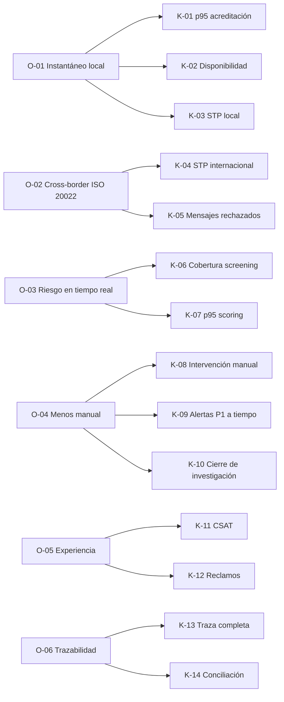

# KPIs — Ficha de indicadores

**Proyecto:** NovaBank Instant & Cross-Border Payments + AML Hub
**Documento:** KPI-NB-001
**Versión:** 1.0
**Fecha:** 2026-10-27
**Autor:** Franco Tillería Centurión — Business Analyst

> Todas las metas son objetivos del caso ficticio. No representan resultados históricos ni compromisos de una entidad real. La línea base se establecerá con datos del piloto; no se inventa.

---

## 1. Cómo leer esta ficha

- **Tipo:** `Lagging` mide resultado; `Leading` mide señal temprana.
- **Frecuencia:** cadencia de cálculo y publicación.
- **Fuente:** sistema o registro del que sale el dato.
- **Dueño:** rol accountable por el resultado y la calidad del dato.
- **Umbral de alerta:** valor que dispara revisión operativa.
- **Meta:** objetivo del caso a la fecha indicada.

Reglas de gobierno:

1. Cada KPI tiene un dueño único y una definición versionada.
2. Los cambios de fórmula requieren aprobación de Producto y Datos.
3. No se reportan métricas sin denominador, periodo y filtro.
4. Los datos personales se agregan o enmascaran.
5. Un KPI sin fuente automatizada se marca como manual y se revisa su automatización.

---

## 2. Árbol de KPIs

---

## 3. Indicadores de pagos

### K-01 — Tiempo de acreditación local p95

| Campo | Valor |
|---|---|
| Definición | Percentil 95 del tiempo entre la aceptación del pago y la acreditación confirmada al beneficiario, para pagos locales exitosos. |
| Fórmula | `percentil_95(ts_acreditacion − ts_aceptacion)` |
| Unidad | Segundos |
| Tipo | Lagging |
| Meta | ≤ 5 s |
| Umbral de alerta | > 8 s durante 15 min |
| Frecuencia | Tiempo real (tablero) y cierre diario |
| Fuente | Motor de pagos + eventos de acreditación |
| Dueño | Gerencia de Operaciones |
| Segmento | P2P, P2B; excluye devoluciones |
| Nota | El objetivo se alinea con la referencia pública del BCP [F-01]. |

### K-02 — Disponibilidad del canal de pagos

| Campo | Valor |
|---|---|
| Definición | Porcentaje de minutos del mes en que el canal acepta y procesa pagos dentro de los SLA. |
| Fórmula | `(minutos_disponibles − minutos_no_disponibles) / minutos_totales × 100` |
| Unidad | % |
| Tipo | Lagging |
| Meta | ≥ 99,9 % mensual |
| Umbral de alerta | < 99,95 % en ventana móvil de 24 h |
| Frecuencia | Tiempo real y mensual |
| Fuente | Monitoreo sintético + incidentes |
| Dueño | TI — Operaciones de Servicios |
| Segmento | Canal digital y API |
| Nota | Excluye mantenimientos planificados aprobados; se reportan aparte. |

### K-03 — Tasa de straight-through processing local

| Campo | Valor |
|---|---|
| Definición | Porcentaje de pagos locales procesados sin intervención manual. |
| Fórmula | `pagos_sin_intervencion / pagos_totales × 100` |
| Unidad | % |
| Tipo | Lagging |
| Meta | ≥ 95 % |
| Umbral de alerta | < 90 % en el día |
| Frecuencia | Diaria |
| Fuente | Motor de pagos + cola de excepciones |
| Dueño | Gerencia de Operaciones |
| Segmento | Todos los pagos locales |
| Nota | Una intervención manual incluye corrección, reintento asistido o liberación. |

### K-04 — Tasa de rechazo por datos inválidos

| Campo | Valor |
|---|---|
| Definición | Porcentaje de intentos rechazados por validaciones de datos (alias, cuenta, moneda, importe, campos obligatorios). |
| Fórmula | `rechazos_por_validacion / intentos_totales × 100` |
| Unidad | % |
| Tipo | Leading |
| Meta | ≤ 2 % |
| Umbral de alerta | > 4 % en 24 h |
| Frecuencia | Diaria |
| Fuente | Registro de validaciones del canal |
| Dueño | Producto — Experiencia de Pagos |
| Segmento | Por canal y tipo de cliente |
| Nota | Se analiza por causa para mejorar formularios y mensajes. |

### K-05 — Tasa de STP internacional

| Campo | Valor |
|---|---|
| Definición | Porcentaje de pagos internacionales salientes enviados y conciliados sin intervención manual ni reparación. |
| Fórmula | `pagos_internacionales_stp / pagos_internacionales_totales × 100` |
| Unidad | % |
| Tipo | Lagging |
| Meta | ≥ 90 % |
| Umbral de alerta | < 80 % en la semana |
| Frecuencia | Semanal |
| Fuente | Adaptador SWIFT/ISO 20022 + conciliación |
| Dueño | Gerencia de Operaciones Internacionales |
| Segmento | USD y EUR |
| Nota | Un mensaje reparado cuenta como no STP. |

### K-06 — Mensajes ISO 20022 rechazados

| Campo | Valor |
|---|---|
| Definición | Porcentaje de mensajes pacs.008 rechazados por el validador o por el corresponsal. |
| Fórmula | `mensajes_rechazados / mensajes_enviados × 100` |
| Unidad | % |
| Tipo | Leading |
| Meta | ≤ 1 % |
| Umbral de alerta | > 2 % en 24 h |
| Frecuencia | Diaria |
| Fuente | Validador ISO 20022 + respuestas pacs.002 |
| Dueño | TI — Integración de Pagos |
| Segmento | Por corresponsal y moneda |
| Nota | Se clasifica por causa: formato, cuenta, límite, compliance. |

---

## 4. Indicadores de riesgo y AML

### K-07 — Cobertura de screening en pagos

| Campo | Valor |
|---|---|
| Definición | Porcentaje de pagos liberados que tuvieron evaluación de screening y scoring registrada. |
| Fórmula | `pagos_evaluados / pagos_liberados × 100` |
| Unidad | % |
| Tipo | Lagging |
| Meta | 100 % |
| Umbral de alerta | < 100 % (incidente) |
| Frecuencia | Diaria |
| Fuente | Motor de decisión + log de auditoría |
| Dueño | Oficial de Cumplimiento |
| Segmento | Local e internacional |
| Nota | Un pago liberado sin evaluación es un incidente de control. |

### K-08 — Tiempo de scoring de riesgo p95

| Campo | Valor |
|---|---|
| Definición | Percentil 95 del tiempo de evaluación de riesgo por pago, desde la solicitud hasta la decisión. |
| Fórmula | `percentil_95(ts_decision − ts_solicitud_scoring)` |
| Unidad | Milisegundos |
| Tipo | Lagging |
| Meta | ≤ 2.000 ms |
| Umbral de alerta | > 3.000 ms durante 15 min |
| Frecuencia | Tiempo real y diaria |
| Fuente | Motor de reglas/decisiones |
| Dueño | TI — Riesgo y Datos |
| Segmento | Por regla y por canal |
| Nota | Incluye screening y scoring, excluye revisión manual. |

### K-09 — Alertas P1 asignadas a tiempo

| Campo | Valor |
|---|---|
| Definición | Porcentaje de alertas de prioridad 1 asignadas a un analista dentro de 15 minutos. |
| Fórmula | `alertas_P1_asignadas_en_15min / alertas_P1_totales × 100` |
| Unidad | % |
| Tipo | Leading |
| Meta | ≥ 95 % |
| Umbral de alerta | < 90 % en el día |
| Frecuencia | Diaria |
| Fuente | Case management AML |
| Dueño | Jefe de Monitoreo AML |
| Segmento | Alertas P1 |
| Nota | El reloj inicia al crearse la alerta. |

### K-10 — Cierre de investigación dentro de plazo

| Campo | Valor |
|---|---|
| Definición | Porcentaje de casos cerrados dentro de 10 días hábiles desde la asignación. |
| Fórmula | `casos_cerrados_en_plazo / casos_cerrados_totales × 100` |
| Unidad | % |
| Tipo | Lagging |
| Meta | ≥ 90 % |
| Umbral de alerta | < 80 % en la semana |
| Frecuencia | Semanal |
| Fuente | Case management AML |
| Dueño | Jefe de Monitoreo AML |
| Segmento | Por prioridad y analista |
| Nota | Una prórroga aprobada se reporta aparte. |

### K-11 — Tasa de falsos positivos

| Campo | Valor |
|---|---|
| Definición | Porcentaje de alertas cerradas como no sospechosas sobre el total de alertas cerradas. |
| Fórmula | `alertas_descartadas / alertas_cerradas × 100` |
| Unidad | % |
| Tipo | Leading |
| Meta | ≤ 30 % |
| Umbral de alerta | > 40 % en el mes |
| Frecuencia | Mensual |
| Fuente | Case management AML |
| Dueño | Oficial de Cumplimiento |
| Segmento | Por regla y por segmento de cliente |
| Nota | Un falso positivo alto puede indicar reglas mal calibradas, no necesariamente relajarlas. |

### K-12 — Oportunidad del ROS

| Campo | Valor |
|---|---|
| Definición | Porcentaje de ROS presentados dentro del plazo interno definido por el caso. |
| Fórmula | `ROS_en_plazo / ROS_totales × 100` |
| Unidad | % |
| Tipo | Lagging |
| Meta | 100 % |
| Umbral de alerta | < 100 % (incidente) |
| Frecuencia | Mensual |
| Fuente | Registro de ROS (ficticio) |
| Dueño | Oficial de Cumplimiento |
| Segmento | Todos los ROS |
| Nota | El plazo interno es un parámetro del caso, no una cita regulatoria. |

---

## 5. Indicadores de experiencia y operación

### K-13 — Satisfacción del cliente con pagos (CSAT)

| Campo | Valor |
|---|---|
| Definición | Promedio de satisfacción declarado después de una transferencia, en escala 1–5. |
| Fórmula | `suma_puntajes / respuestas_validas` |
| Unidad | Puntos (1–5) |
| Tipo | Lagging |
| Meta | ≥ 4,3 |
| Umbral de alerta | < 4,0 en la semana |
| Frecuencia | Semanal |
| Fuente | Encuesta post-transacción |
| Dueño | Producto — Experiencia de Cliente |
| Segmento | Por canal y tipo de pago |
| Nota | Tasa de respuesta mínima del 5 % para reportar. |

### K-14 — Reclamos por pago

| Campo | Valor |
|---|---|
| Definición | Porcentaje de pagos con reclamo formal sobre el total de pagos. |
| Fórmula | `pagos_con_reclamo / pagos_totales × 100` |
| Unidad | % |
| Tipo | Lagging |
| Meta | < 0,5 % |
| Umbral de alerta | > 1 % en la semana |
| Frecuencia | Semanal |
| Fuente | CRM de reclamos |
| Dueño | Gerencia de Atención al Cliente |
| Segmento | Por motivo y canal |
| Nota | Se excluyen consultas informativas sin reclamo. |

### K-15 — Intervención manual en pagos

| Campo | Valor |
|---|---|
| Definición | Porcentaje de pagos que requirieron al menos una acción manual. |
| Fórmula | `pagos_con_intervencion / pagos_totales × 100` |
| Unidad | % |
| Tipo | Lagging |
| Meta | ≤ 5 % |
| Umbral de alerta | > 10 % en el día |
| Frecuencia | Diaria |
| Fuente | Motor de pagos + cola de excepciones |
| Dueño | Gerencia de Operaciones |
| Segmento | Local e internacional |
| Nota | Complementa K-03 y K-05 con visión de esfuerzo. |

### K-16 — Trazabilidad completa de la operación

| Campo | Valor |
|---|---|
| Definición | Porcentaje de operaciones con todos los eventos obligatorios registrados y correlacionados por identificador. |
| Fórmula | `operaciones_con_traza_completa / operaciones_totales × 100` |
| Unidad | % |
| Tipo | Lagging |
| Meta | ≥ 99,5 % |
| Umbral de alerta | < 99 % en el día |
| Frecuencia | Diaria |
| Fuente | Log de auditoría + motor de pagos |
| Dueño | Auditoría Interna / TI |
| Segmento | Todas las operaciones |
| Nota | Un evento faltante es un hallazgo de control. |

### K-17 — Conciliación contable

| Campo | Valor |
|---|---|
| Definición | Porcentaje de asientos conciliados contra el riel y el core al cierre del día. |
| Fórmula | `asientos_conciliados / asientos_totales × 100` |
| Unidad | % |
| Tipo | Lagging |
| Meta | ≥ 99,5 % |
| Umbral de alerta | < 99 % al cierre |
| Frecuencia | Diaria |
| Fuente | Libro mayor + conciliación |
| Dueño | Contraloría |
| Segmento | Local, internacional y devoluciones |
| Nota | Las diferencias deben tener explicación y dueño. |

---

## 6. Resumen ejecutivo de metas

| ID | KPI | Meta | Frecuencia | Dueño |
|---|---|---|---|---|
| K-01 | p95 acreditación local | ≤ 5 s | Tiempo real/diaria | Operaciones |
| K-02 | Disponibilidad | ≥ 99,9 % | Mensual | TI |
| K-03 | STP local | ≥ 95 % | Diaria | Operaciones |
| K-04 | Rechazo por datos | ≤ 2 % | Diaria | Producto |
| K-05 | STP internacional | ≥ 90 % | Semanal | Operaciones Intl. |
| K-06 | Mensajes ISO rechazados | ≤ 1 % | Diaria | TI |
| K-07 | Cobertura screening | 100 % | Diaria | Cumplimiento |
| K-08 | p95 scoring | ≤ 2.000 ms | Tiempo real/diaria | TI |
| K-09 | Alertas P1 a tiempo | ≥ 95 % | Diaria | Monitoreo AML |
| K-10 | Cierre de investigación | ≥ 90 % | Semanal | Monitoreo AML |
| K-11 | Falsos positivos | ≤ 30 % | Mensual | Cumplimiento |
| K-12 | ROS en plazo | 100 % | Mensual | Cumplimiento |
| K-13 | CSAT | ≥ 4,3 | Semanal | Producto |
| K-14 | Reclamos | < 0,5 % | Semanal | Atención |
| K-15 | Intervención manual | ≤ 5 % | Diaria | Operaciones |
| K-16 | Traza completa | ≥ 99,5 % | Diaria | Auditoría/TI |
| K-17 | Conciliación | ≥ 99,5 % | Diaria | Contraloría |

---

## 7. Línea base y plan de medición

No se declara una línea base porque el caso es ficticio y no se ejecutó un piloto. Para cada KPI se debe:

1. Definir la ventana de medición (mínimo 4 semanas o 1.000 operaciones).
2. Instrumentar el evento o consulta que alimenta el cálculo.
3. Validar la fuente con Datos y Auditoría.
4. Congelar la definición v1.0 antes del lanzamiento.
5. Reportar la primera medición como “línea base”, sin compararla con metas hasta tener 3 periodos.

---

## 8. Antipatrones y calidad del dato

| Riesgo | Control |
|---|---|
| Meta sin dueño | Dueño obligatorio en la ficha. |
| Denominador manipulado | Fórmula y filtros versionados. |
| Datos incompletos | Semáforo de calidad y exclusión documentada. |
| Métricas contradictorias | Un solo diccionario de datos. |
| Optimización local | Revisión mensual del árbol de KPIs. |
| Exposición de PII | Agregación y enmascaramiento. |
| Reporte manual | Automatización priorizada por criticidad. |

---

## 9. Referencias

- `BRD.md` — objetivos y beneficios.
- `02-procesos/` — procesos que generan los eventos.
- `docs/FUENTES.md` — referencias normativas y técnicas.
- `docs/PENDIENTES.md` — brechas que afectan la medición.
