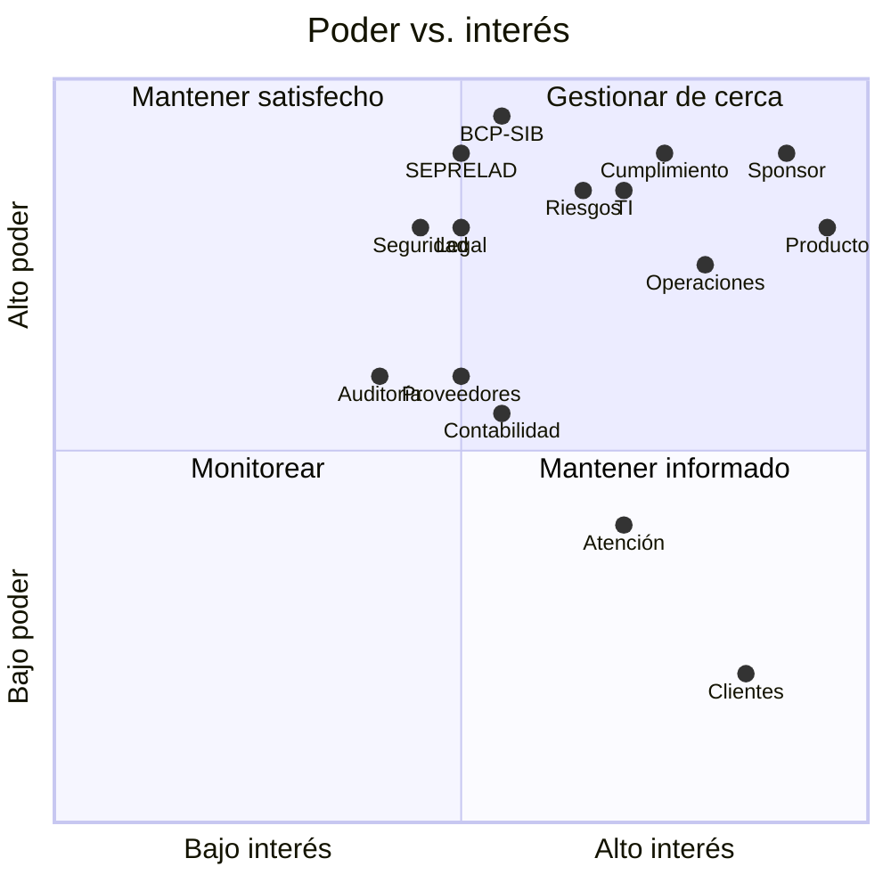
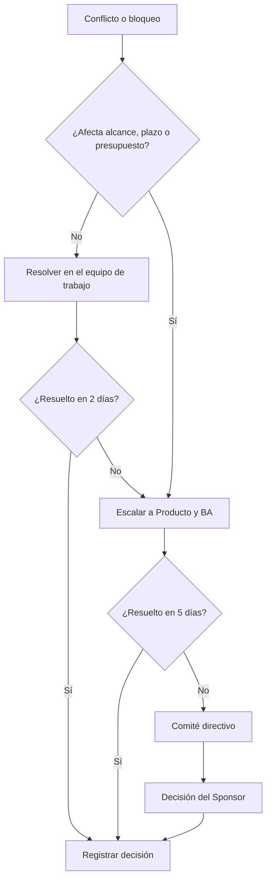

# Stakeholders, RACI y plan de involucramiento

**Proyecto:** NovaBank Instant & Cross-Border Payments + AML Hub
**Documento:** STK-NB-001
**Versión:** 1.0
**Fecha:** 2026-10-27
**Autor:** Franco Tillería Centurión — Business Analyst

> Todos los roles y nombres de área son ficticios. No se identifican personas reales ni estructuras internas de empleadores reales.

---

## 1. Objetivo

Identificar a las partes interesadas, entender su poder e interés, definir cómo se involucran, quién decide qué y cómo se escalan los conflictos.

---

## 2. Mapa de stakeholders

| ID | Stakeholder | Tipo | Rol en el proyecto | Interés principal | Influencia |
|---|---|---|---|---|---|
| ST-01 | Gerencia de Banca Minorista | Interno | Sponsor | Resultado comercial, adopción, ROI | Alta |
| ST-02 | Producto — Pagos | Interno | Product Owner | Alcance, prioridad, time to market | Alta |
| ST-03 | Business Analyst | Interno | Autor del análisis funcional | Claridad, trazabilidad, calidad | Media |
| ST-04 | Gerencia de Operaciones | Interno | Dueño del proceso operativo | Eficiencia, SLA, excepciones | Alta |
| ST-05 | Operaciones Internacionales | Interno | Proceso cross-border | STP, corresponsalía, rechazos | Media |
| ST-06 | TI — Arquitectura | Interno | Diseño técnico e integración | Estabilidad, seguridad, mantenibilidad | Alta |
| ST-07 | TI — Integración de Pagos | Interno | Conectores SPI/SWIFT/ISO 20022 | Mensajería, idempotencia, monitoreo | Alta |
| ST-08 | TI — Datos y Analítica | Interno | Datos, reporting y KPIs | Calidad de dato, tableros | Media |
| ST-09 | Riesgos | Interno | Riesgo operacional y fraude | Pérdidas, controles, apetito | Alta |
| ST-10 | Cumplimiento / AML | Interno | KYC, screening, monitoreo, ROS | Cumplimiento, evidencia, SLA | Alta |
| ST-11 | Contraloría / Contabilidad | Interno | Partida doble y conciliación | Exactitud, cierres | Media |
| ST-12 | Atención al Cliente | Interno | Soporte y reclamos | Resolución, experiencia | Media |
| ST-13 | Auditoría Interna | Interno | Aseguramiento | Diseño y efectividad de controles | Media |
| ST-14 | Legal | Interno | Contratos, privacidad, normativa | Riesgo legal, cumplimiento | Alta |
| ST-15 | Seguridad de la Información | Interno | Controles de seguridad | Confidencialidad, integridad | Alta |
| ST-16 | Clientes personas | Externo | Usuarios finales | Rapidez, claridad, disponibilidad | Baja |
| ST-17 | Clientes empresas | Externo | Usuarios finales | Integración, límites, conciliación | Media |
| ST-18 | BCP / SIB | Externo | Regulador | Cumplimiento, estabilidad | Alta |
| ST-19 | SEPRELAD | Externo | UIF | Reporte y controles AML | Alta |
| ST-20 | Banco corresponsal | Externo | Contraparte internacional | Mensajería, cumplimiento, SLA | Media |
| ST-21 | Proveedor de screening | Externo | Listas y motor | Cobertura, precisión, disponibilidad | Media |
| ST-22 | Proveedor de mensajería/SWIFT | Externo | Red y estándares | Conectividad, certificación | Alta |

---

## 3. Poder, interés y estrategia

| Cuadrante | Stakeholders | Estrategia |
|---|---|---|
| Gestionar de cerca | Sponsor, Producto, Operaciones, Cumplimiento, TI, Riesgos | Involucramiento continuo, decisiones conjuntas, comité quincenal. |
| Mantener satisfecho | BCP/SIB, SEPRELAD, Legal, Seguridad, SWIFT | Información ejecutiva, evidencias y cumplimiento de plazos. |
| Mantener informado | Atención al Cliente, Contabilidad, Auditoría, clientes empresa | Comunicación periódica, demos y material de soporte. |
| Monitorear | Clientes personas, proveedores de menor criticidad | Encuestas, soporte y revisión de SLA. |

---

## 4. Plan de involucramiento

| ID | Stakeholder | Objetivo de involucramiento | Mecanismo | Frecuencia | Dueño |
|---|---|---|---|---|---|
| ST-01 | Sponsor | Aprobar alcance, presupuesto y prioridades. | Comité directivo | Mensual | Producto |
| ST-02 | Producto | Definir valor y priorizar backlog. | Refinamiento y demos | Semanal | BA |
| ST-04 | Operaciones | Validar procesos, excepciones y SLA. | Taller operativo | Quincenal | BA |
| ST-06 | TI | Validar arquitectura, integración y seguridad. | Revisión técnica | Semanal | BA/TI |
| ST-09 | Riesgos | Aprobar apetito y controles. | Taller de riesgos | Quincenal | BA |
| ST-10 | Cumplimiento | Validar KYC, screening, alertas y ROS. | Revisión de cumplimiento | Semanal | BA |
| ST-11 | Contabilidad | Validar partida doble y conciliación. | Taller de cierre | Quincenal | BA |
| ST-12 | Atención | Preparar soporte y reclamos. | Capacitación | Por hito | Producto |
| ST-13 | Auditoría | Revisar evidencia y controles. | Revisión de aseguramiento | Por hito | BA |
| ST-18 | BCP/SIB | Cumplir reportes y requerimientos. | Comunicación formal | Según normativa | Cumplimiento |
| ST-19 | SEPRELAD | Reportar ROS cuando corresponda. | Canal oficial (ficticio) | Según evento | Cumplimiento |
| ST-20 | Corresponsal | Acordar mensajería, SLA y devoluciones. | Reunión de contraparte | Mensual | Operaciones Intl. |
| ST-21 | Proveedor screening | Asegurar cobertura y calidad de listas. | Revisión de servicio | Trimestral | Cumplimiento |
| ST-22 | SWIFT | Mantener conectividad y estándares. | Revisión de servicio | Trimestral | TI |

---

## 5. Matriz RACI

**R** = Responsible (hace), **A** = Accountable (rinde cuentas, uno por fila), **C** = Consulted, **I** = Informed.

| Actividad | Sponsor | Producto | BA | Operaciones | TI | Riesgos | Cumplimiento | Contabilidad | Legal | Auditoría |
|---|---|---|---|---|---|---|---|---|---|---|
| Aprobar visión y alcance | A | R | C | C | C | C | C | I | C | I |
| Priorizar backlog | A | R | C | C | C | C | C | I | I | I |
| Levantar requerimientos | I | C | A/R | C | C | C | C | C | C | I |
| Diseñar procesos | I | C | A/R | R | C | C | C | C | I | I |
| Definir reglas AML | I | C | C | C | C | C | A/R | I | C | I |
| Aprobar apetito de riesgo | A | C | C | C | C | R | C | I | C | I |
| Arquitectura e integración | I | C | C | C | A/R | C | C | I | I | I |
| Modelo contable | I | I | C | C | C | I | I | A/R | I | I |
| Plan de pruebas y UAT | I | A | R | R | R | C | C | C | I | C |
| Validación legal | I | I | C | I | I | C | C | I | A/R | I |
| Aprobación de salida a producción | A | R | C | R | R | C | C | C | C | I |
| Gestión de incidentes | I | I | I | A/R | R | C | C | I | I | I |
| Reporte de KPIs | I | A | C | R | R | C | C | R | I | I |
| Documentación y trazabilidad | I | C | A/R | C | C | C | C | C | C | I |

### 5.1 Reglas RACI

1. Cada actividad tiene un único **A**.
2. El **A** no delega la rendición de cuentas, aunque delegue el trabajo.
3. Un stakeholder consultado debe responder antes del cierre de la actividad.
4. Los informados reciben el resultado, no deciden.
5. Los desacuerdos se escalan según la sección 7.

---

## 6. Derechos de decisión

| Decisión | Decide | Consulta | Informa |
|---|---|---|---|
| Visión, alcance y presupuesto | Sponsor | Producto, TI, Riesgos | Comité |
| Prioridad del backlog | Producto | Sponsor, Operaciones | BA, TI |
| Diseño funcional del proceso | BA (con Operaciones) | TI, Riesgos, Cumplimiento | Producto |
| Reglas y umbrales AML | Cumplimiento | Riesgos, Legal | Producto, TI |
| Arquitectura e integración | TI | BA, Seguridad | Producto |
| Modelo contable | Contabilidad | TI, Operaciones | Producto |
| Aprobación de riesgo residual | Riesgos | Cumplimiento, Sponsor | Comité |
| Salida a producción | Sponsor (con TI y Operaciones) | Riesgos, Cumplimiento | Comité |
| Comunicación a clientes | Producto | Legal, Atención | Sponsor |
| Reporte regulatorio | Cumplimiento | Legal | Sponsor |

---

## 7. Escalamiento

**Criterios de escalamiento inmediato:** riesgo regulatorio, incidente de seguridad, fraude, indisponibilidad de un riel, o desacuerdo que impide avanzar una fase.

---

## 8. Plan de comunicación

| Artefacto | Audiencia | Frecuencia | Canal | Dueño |
|---|---|---|---|---|
| Acta de comité | Sponsor y líderes | Mensual | Confluence (ficticio) | Producto |
| Estado del proyecto | Todos | Semanal | Correo/Teams (ficticio) | BA |
| Demo funcional | Producto, Operaciones, TI | Quincenal | Sesión remota | BA |
| Reporte de KPIs | Sponsor y comité | Mensual | Power BI (especificado) | Datos |
| Alerta de riesgo | Riesgos y Sponsor | Según evento | Correo y comité | Riesgos |
| Comunicación de cambio | Usuarios y atención | Por release | Intranet/correo | Producto |
| Runbook operativo | Operaciones y soporte | Por versión | Confluence | Operaciones |
| Evidencia de pruebas | Auditoría y Cumplimiento | Por hito | Repositorio documental | BA |

---

## 9. Necesidades e intereses por stakeholder

| Stakeholder | Necesidad | Miedo/riesgo | Cómo se cubre |
|---|---|---|---|
| Sponsor | Resultado comercial y control de costo | Inversión sin adopción | KPIs, hitos y comité |
| Producto | Time to market y valor | Alcance desbordado | MoSCoW y backlog priorizado |
| Operaciones | Menos manual, SLA claros | Más excepciones | Procesos TO-BE y runbook |
| TI | Diseño estable y seguro | Deuda técnica | Arquitectura modular y NFR |
| Riesgos | Controles efectivos | Fraude y pérdidas | Reglas, límites y monitoreo |
| Cumplimiento | Evidencia y cumplimiento | Sanción regulatoria | Trazabilidad y ROS |
| Contabilidad | Exactitud | Diferencias | Partida doble y conciliación |
| Atención | Información para resolver | Cliente sin respuesta | Estado del pago y guion |
| Auditoría | Evidencia completa | Hallazgos | Logs y casos |
| Legal | Cumplimiento y privacidad | Contratos o datos | Revisión y minimización |
| Cliente | Rapidez y claridad | Pérdida de dinero | Confirmación y soporte |

---

## 10. Riesgos de stakeholders

| ID | Riesgo | Probabilidad | Impacto | Mitigación |
|---|---|---|---|---|
| SR-01 | Baja participación de Operaciones en el diseño. | Media | Alto | Talleres obligatorios y validación de procesos. |
| SR-02 | Cumplimiento no valida reglas a tiempo. | Media | Alto | Revisión semanal y criterios de aceptación. |
| SR-03 | TI prioriza otros proyectos. | Media | Alto | Capacidad comprometida en comité. |
| SR-04 | Sponsor cambia el alcance. | Media | Medio | Control de cambios y comité. |
| SR-05 | Proveedor de screening no cumple SLA. | Baja | Alto | Cláusulas, plan de contingencia y monitoreo. |
| SR-06 | Cliente no adopta el canal. | Media | Medio | Campaña, usabilidad y soporte. |
| SR-07 | Regulador solicita información no prevista. | Baja | Alto | Expediente y trazabilidad. |

---

## 11. Criterios de éxito del involucramiento

- Todos los stakeholders clave conocen alcance y decisiones.
- Las validaciones quedan registradas con fecha y responsable.
- Los desacuerdos se resuelven o escalan dentro de los plazos.
- Operaciones y Cumplimiento participan antes de la aprobación funcional.
- El plan de comunicación se ejecuta y se evidencia.

---

## 12. Referencias

- `BRD.md` — alcance, objetivos y requerimientos.
- `riesgos.md` — registro de riesgos del proyecto.
- `docs/EVIDENCIAS.md` — acciones manuales y capturas.
- `docs/SUPUESTOS.md` — supuestos de roles y aprobaciones.
