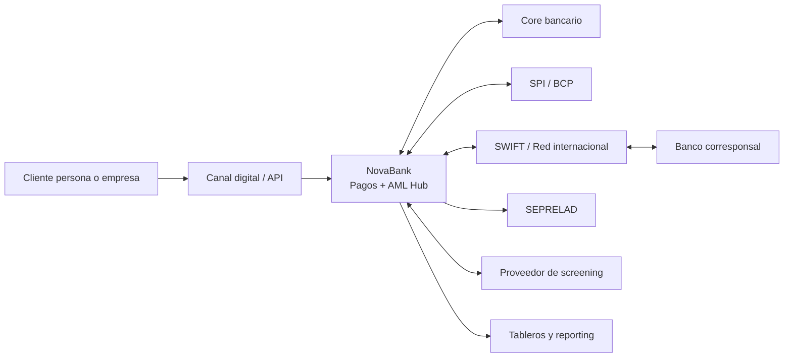
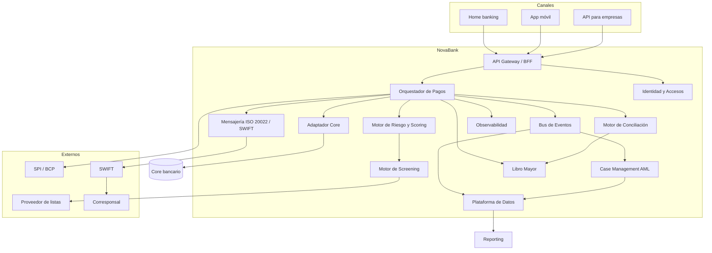
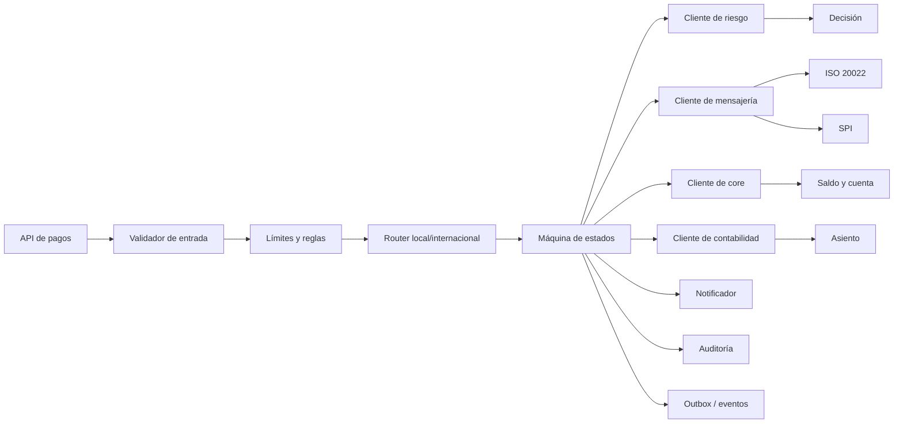
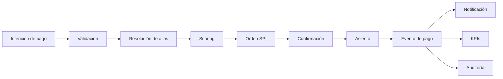
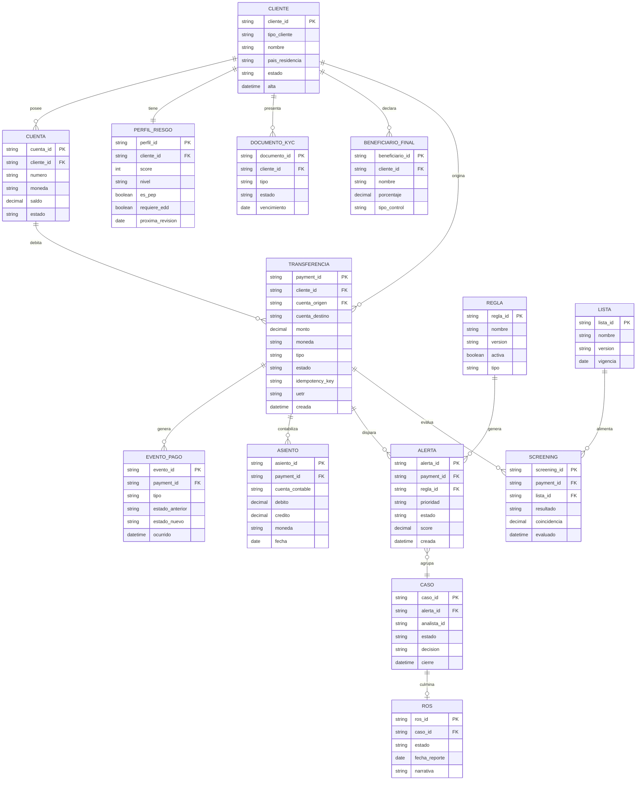
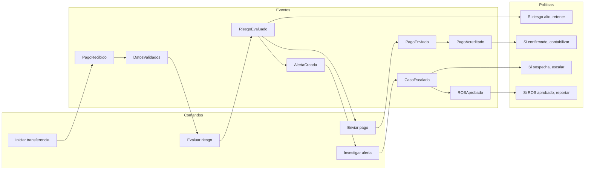
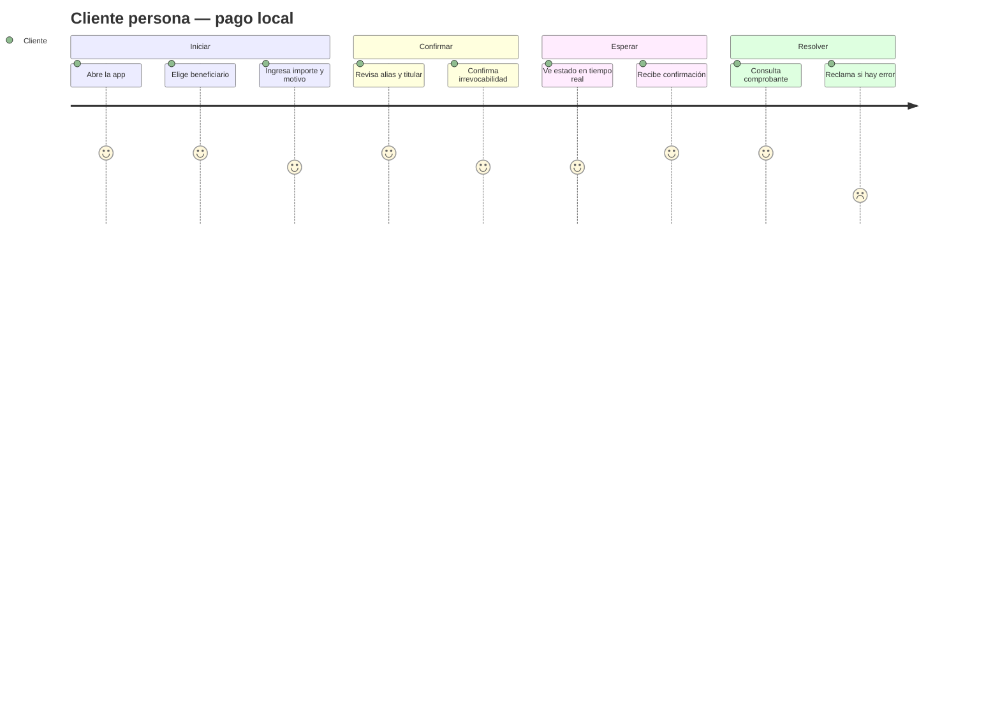
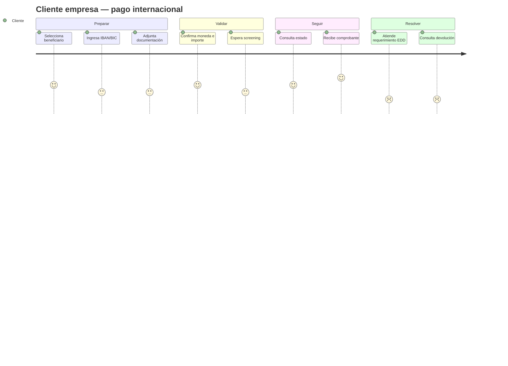
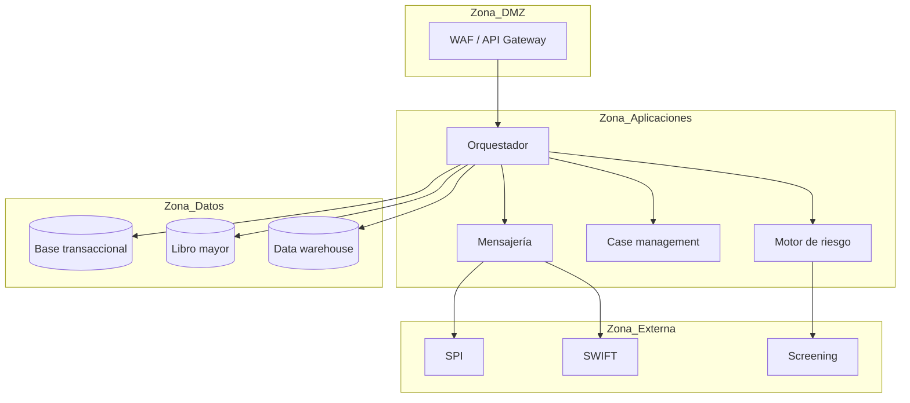

# Diagramas de sistema, datos y experiencia

**Proyecto:** NovaBank Instant & Cross-Border Payments + AML Hub
**Documento:** DIA-NB-001
**Versión:** 1.0
**Fecha:** 2026-10-27

> Arquitectura conceptual y preliminar. No representa la arquitectura real de ninguna entidad. El detalle de implementación se define en Fase 3.

---

## 1. Contexto (C4 nivel 1)

**Fronteras:** NovaBank controla canal, orquestación, riesgo, contabilidad y reporting. SPI, SWIFT, corresponsal y proveedor de screening son externos.

---

## 2. Contenedores (C4 nivel 2)

**Notas:**
- El orquestador es el dueño de la máquina de estados del pago.
- El motor de riesgo decide; el screening aporta coincidencias.
- El case management es el sistema de registro de alertas y ROS.
- El bus de eventos alimenta datos, auditoría y tableros.

---

## 3. Componentes del orquestador

**Patrones:** outbox transaccional, idempotencia, saga para pasos distribuidos, reintentos con backoff y dead-letter queue.

---

## 4. Integraciones

| Integración | Dirección | Protocolo | Datos | Riesgo | Control |
|---|---|---|---|---|---|
| Canal → API Gateway | Entrada | HTTPS/JSON | Intención de pago | Suplantación | OAuth2, mTLS, rate limit |
| Orquestador → Core | Bidireccional | API | Cuenta, saldo, débito/crédito | Consistencia | Idempotencia, timeout, compensación |
| Orquestador → SPI | Bidireccional | Adaptador/ISO | Orden y estado | Indisponibilidad | Reintentos, conciliación |
| Orquestador → SWIFT | Bidireccional | ISO 20022 | pacs.008/pacs.002 | Rechazo | Validador, correlación |
| Orquestador → Screening | Salida | API | Persona/operación | Falso positivo | Listas versionadas, revisión |
| Orquestador → Ledger | Salida | API/evento | Asiento | Diferencia | Partida doble, conciliación |
| Case Management → UIF | Salida | Canal oficial simulado | ROS | Reserva | Control de acceso |
| Bus → Data Platform | Salida | Eventos | Métricas y casos | PII | Enmascaramiento |

---

## 5. Flujo de datos de un pago local

**Datos mínimos:** `payment_id`, `idempotency_key`, `cliente_id`, `cuenta_origen`, `cuenta_destino`, `alias`, `monto`, `moneda`, `estado`, `motivo`, `timestamp`, `regla_version`, `score`, `uetr` (internacional).

---

## 6. Modelo entidad-relación preliminar

> Modelo conceptual. El DDL, índices, constraints y tipos definitivos se definen en Fase 3.

---

## 7. Event storming

---

## 8. Journey — pago local P2P

**Puntos de dolor:** confirmación de titular, claridad de irrevocabilidad y tiempos de respuesta.

---

## 9. Journey — pago internacional

**Puntos de dolor:** errores de IBAN/BIC, solicitudes EDD y falta de visibilidad del estado.

---

## 10. Despliegue conceptual

**Zonas de seguridad:** DMZ para exposición, aplicaciones con mínimo privilegio, datos cifrados y externos con mTLS.

---

## 11. Decisiones de arquitectura preliminares

| ID | Decisión | Motivo | Consecuencia |
|---|---|---|---|
| ADR-01 | Orquestador con máquina de estados explícita. | Evitar estados ambiguos y duplicados. | Más complejidad inicial, mejor control. |
| ADR-02 | Idempotencia por `idempotency_key` y `payment_id`. | Reintentos seguros. | Requiere unicidad y retención. |
| ADR-03 | Outbox transaccional para eventos. | Consistencia entre pago y evento. | Necesita relay y monitoreo. |
| ADR-04 | Screening síncrono antes de liberar. | Control AML oportuno. | Latencia y dependencia del proveedor. |
| ADR-05 | Case management como sistema de registro AML. | Evidencia y auditoría. | Integración y gobierno de datos. |
| ADR-06 | Ledger separado del core para conciliación. | Trazabilidad contable. | Doble registro y conciliación. |
| ADR-07 | ISO 20022 como contrato canónico internacional. | Estándar y futuro. | Mapeo y validación. |
| ADR-08 | Bus de eventos para analítica y auditoría. | Desacoplar reporting. | Gobierno de esquemas. |

---

## 12. Atributos de calidad y controles

| Atributo | Escenario | Control |
|---|---|---|
| Disponibilidad | Caída de un nodo sin afectar pagos. | Réplicas, balanceo, health checks. |
| Rendimiento | p95 de scoring ≤ 2 s. | Caché, reglas optimizadas, índices. |
| Consistencia | No duplicar pagos. | Idempotencia y saga. |
| Auditabilidad | Reconstruir un pago. | Eventos correlacionados y retención. |
| Seguridad | Acceso no autorizado. | IAM, mTLS, cifrado, mínimo privilegio. |
| Observabilidad | Detectar falla en < 5 min. | Métricas, trazas, alertas. |
| Recuperación | Restablecer en RTO definido. | Backups, DR, pruebas. |
| Privacidad | Evitar PII innecesaria. | Minimización y enmascaramiento. |

---

## 13. Trazabilidad de diagramas

| Diagrama | Requerimientos | Procesos |
|---|---|---|
| Contexto | BR-01, BR-05, BR-07 | PR-01 a PR-06 |
| Contenedores | NFR-01 a NFR-10 | Transversal |
| Componentes | BR-15, NFR-02 | PR-02, PR-03 |
| ER | BR-10, BR-11, BR-12 | PR-01, PR-05, PR-06 |
| Event storming | BR-07, BR-08, BR-09 | PR-04, PR-05 |
| Journeys | BR-03, BR-16 | PR-02, PR-03 |
| Despliegue | NFR-01, NFR-03, NFR-07 | Transversal |

---

## 14. Referencias

- `mapa-procesos.md` — procesos y controles.
- `bpmn/` — modelos BPMN.
- `dmn/` — decisiones.
- `../01-negocio/BRD.md` — requerimientos y NFR.
- `../01-negocio/contexto-regulatorio.md` — restricciones.
