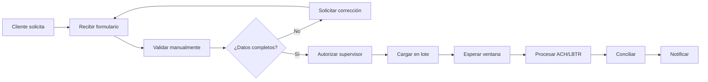

# Mapa de procesos

**Proyecto:** NovaBank Instant & Cross-Border Payments + AML Hub
**Documento:** MAP-NB-001
**Versión:** 1.0
**Fecha:** 2026-10-27
**Autor:** Franco Tillería Centurión — Business Analyst

> Procesos del caso ficticio. Los diagramas BPMN y DMN son artefactos de diseño; no se ejecutan en un motor en esta fase.

---

## 1. Propósito

Describir la arquitectura de procesos de NovaBank para pagos locales, pagos internacionales y AML, identificar el AS-IS, definir el TO-BE y establecer prioridades y dependencias para el diseño funcional.

---

## 2. Principios de diseño

1. **Pago y riesgo en un solo flujo:** el screening y el scoring ocurren antes de liberar el pago, no después.
2. **Confirmación antes de irrevocabilidad:** el cliente ve beneficiario, importe y consecuencias antes de confirmar.
3. **Idempotencia por diseño:** cada operación tiene un identificador único y una máquina de estados.
4. **Trazabilidad extremo a extremo:** todo evento relevante se registra con correlación.
5. **Excepción con dueño y plazo:** toda desviación entra a una cola con responsable y SLA.
6. **Parametrización controlada:** límites y reglas se configuran con versión y aprobación.
7. **Cumplimiento por diseño:** KYC, screening, monitoreo y ROS son parte del proceso, no un apéndice.
8. **Contabilidad por partida doble:** todo movimiento económico genera asientos balanceados.
9. **Experiencia simple:** el cliente no ve la complejidad interna; ve estado y próximo paso.
10. **Evidencia desde el primer día:** logs, casos y decisiones listos para auditoría.

---

## 3. Cadena de valor (Nivel 0)

### 3.1 Procesos de dirección

- Estrategia de pagos y producto.
- Gobierno de riesgo y cumplimiento.
- Gestión de proveedores y contrapartes.
- Gestión de cambios y arquitectura.

### 3.2 Procesos operativos

- Onboarding y KYC.
- Transferencia local instantánea.
- Transferencia internacional.
- Gestión de alertas AML.
- Investigación y ROS.
- Conciliación y contabilidad.
- Atención de reclamos.

### 3.3 Procesos de soporte

- Datos y analítica.
- Seguridad de la información.
- Infraestructura y observabilidad.
- Capacitación y gestión del cambio.
- Auditoría interna.

---

## 4. Inventario de procesos

| ID | Proceso | Nivel | Tipo | Dueño | Criticidad | Estado | Artefacto |
|---|---|---|---|---|---|---|---|
| PR-01 | Onboarding y KYC | 1 | Operativo | Cumplimiento | Alta | TO-BE | `bpmn/onboarding-kyc.bpmn` |
| PR-02 | Transferencia instantánea local | 1 | Operativo | Operaciones | Alta | AS-IS / TO-BE | `bpmn/transferencia-instantanea-as-is.bpmn`, `bpmn/transferencia-instantanea-to-be.bpmn` |
| PR-03 | Transferencia internacional saliente | 1 | Operativo | Operaciones Intl. | Alta | TO-BE | `bpmn/transferencia-internacional-to-be.bpmn` |
| PR-04 | Monitoreo transaccional | 1 | Operativo | Monitoreo AML | Alta | TO-BE | `dmn/scoring-riesgo-cliente.dmn`, `dmn/ruteo-riesgo-transferencia.dmn` |
| PR-05 | Gestión de alertas AML | 1 | Operativo | Monitoreo AML | Alta | TO-BE | `bpmn/alerta-aml.bpmn` |
| PR-06 | Investigación y ROS | 1 | Operativo | Cumplimiento | Alta | TO-BE | `bpmn/investigacion-ros.bpmn` |
| PR-07 | Devoluciones y reclamos | 2 | Operativo | Operaciones | Media | TO-BE | `bpmn/transferencia-instantanea-to-be.bpmn` |
| PR-08 | Conciliación y contabilidad | 1 | Soporte | Contraloría | Alta | TO-BE | Fase 3 |
| PR-09 | Reporting operativo y AML | 1 | Soporte | Datos | Media | TO-BE | Fase 6 |
| PR-10 | Gestión de reglas y parámetros | 1 | Dirección | Riesgos/Producto | Alta | TO-BE | DMN + Fase 5 |
| PR-11 | Gestión de incidentes | 2 | Soporte | TI | Alta | TO-BE | Fase 4 |
| PR-12 | Capacitación y cambio | 2 | Soporte | Operaciones | Media | TO-BE | Fase 7 |
| PR-13 | Auditoría y evidencia | 2 | Dirección | Auditoría | Media | TO-BE | Transversal |
| PR-14 | Revisión periódica de cliente | 2 | Operativo | Cumplimiento | Media | TO-BE | `bpmn/onboarding-kyc.bpmn` |

---

## 5. Procesos AS-IS

### 5.1 Transferencia local AS-IS

| Elemento | Descripción |
|---|---|
| Disparador | Cliente solicita transferencia por banca en línea, app o ventanilla. |
| Entradas | Formulario, cuenta origen, cuenta/alias destino, importe. |
| Actividades | Recepción, validación manual, autorización, carga en lote, procesamiento, conciliación, notificación. |
| Salidas | Transferencia procesada o rechazada; comprobante; asiento contable. |
| Sistemas | Canal, back office, core, ACH/LBTR, correo. |
| Problemas | Validación manual, dependencia de horario, estados inconsistentes, reprocesos, poca trazabilidad. |
| Métricas AS-IS | No medidas en el caso; se establecen como línea base en el piloto. |

### 5.2 Onboarding AS-IS

| Elemento | Descripción |
|---|---|
| Disparador | Persona solicita apertura de cuenta. |
| Entradas | Documento de identidad, datos personales, comprobante de domicilio. |
| Actividades | Recepción presencial, digitalización, validación, consulta de listas, aprobación, alta. |
| Salidas | Cliente creado o rechazado. |
| Problemas | Documentos incompletos, validación manual, tiempos variables, evidencia dispersa. |

### 5.3 Gestión de alertas AS-IS

| Elemento | Descripción |
|---|---|
| Disparador | Regla de monitoreo genera una alerta. |
| Entradas | Transacción, cliente, regla, historial. |
| Actividades | Recepción por correo, revisión en hoja de cálculo, asignación informal, investigación, cierre. |
| Salidas | Caso cerrado o escalado. |
| Problemas | Sin priorización, sin SLA, evidencia incompleta, riesgo de pérdida de casos. |

---

## 6. Procesos TO-BE

### 6.1 Onboarding y KYC (PR-01)

**Objetivo:** alta digital con debida diligencia proporcional al riesgo y decisión trazable.

| Paso | Responsable | Sistema | Resultado |
|---|---|---|---|
| 1. Solicitud de alta | Cliente | Canal digital | Datos iniciales capturados. |
| 2. Validación de identidad | Canal/KYC | Servicio de identidad | Identidad verificada o pendiente. |
| 3. Screening | AML | Motor de screening | Coincidencias y nivel de riesgo. |
| 4. Evaluación de riesgo | AML | DMN scoring | Perfil y requisitos de EDD. |
| 5. Documentación adicional | Cliente | Canal | Evidencia complementaria. |
| 6. Aprobación/rechazo | Cumplimiento | Case management | Decisión y motivo. |
| 7. Alta de cliente | Core | Core banking | Cliente y cuenta creados. |
| 8. Revisión periódica | AML | Motor de reglas | Reevaluación programada. |

**Excepciones:** identidad no verificable, coincidencia en listas, PEP, beneficiario final incompleto, documentación vencida, rechazo por riesgo.

**Controles:** C-19 a C-24 (ver sección 9).

### 6.2 Transferencia instantánea local TO-BE (PR-02)

**Objetivo:** pagar en segundos, 24/7, con control de riesgo y confirmación.

| Paso | Responsable | Sistema | Resultado |
|---|---|---|---|
| 1. Iniciar pago | Cliente | Canal | Intención registrada. |
| 2. Resolver alias/cuenta | Motor | Directorio interno | Titular y cuenta. |
| 3. Validar datos/límites | Motor | Reglas | Apto o rechazado. |
| 4. Verificar saldo | Core | Core banking | Saldo suficiente. |
| 5. Evaluar riesgo | AML | Screening + DMN | Decisión. |
| 6. Enviar al SPI | Motor | Adaptador SPI | Orden enviada. |
| 7. Confirmar | Motor | SPI | Acreditación. |
| 8. Registrar y notificar | Core/Canal | Core + notificaciones | Asiento y aviso. |
| 9. Devolución (excepción) | Operaciones | Case management | Devolución en plazo. |

**Excepciones:** alias inexistente, límite excedido, saldo insuficiente, rechazo AML, timeout, rechazo del SPI, devolución.

### 6.3 Transferencia internacional TO-BE (PR-03)

**Objetivo:** enviar pagos salientes en USD/EUR con ISO 20022, validación y seguimiento.

| Paso | Responsable | Sistema | Resultado |
|---|---|---|---|
| 1. Capturar instrucción | Cliente | Canal | Datos del pago. |
| 2. Validar IBAN/BIC/moneda | Motor | Validador | Datos válidos. |
| 3. Evaluar riesgo | AML | Screening + DMN | Decisión. |
| 4. Generar pacs.008 | Mensajería | Generador ISO 20022 | Mensaje. |
| 5. Validar esquema | Mensajería | Validador | Mensaje válido. |
| 6. Enviar a SWIFT | Mensajería | Adaptador | Mensaje enviado. |
| 7. Procesar pacs.002 | Mensajería | Adaptador | Estado. |
| 8. Conciliar | Contabilidad | Libro mayor | Asiento conciliado. |
| 9. Gestionar rechazo/devolución | Operaciones | Case management | Caso resuelto. |

**Excepciones:** IBAN/BIC inválido, moneda no soportada, rechazo de screening, mensaje rechazado, timeout, devolución del corresponsal.

### 6.4 Monitoreo transaccional (PR-04)

**Objetivo:** detectar operaciones inusuales antes o después del pago, según el riesgo.

| Regla | Descripción | Acción |
|---|---|---|
| RULE-01 | Importe ≥ umbral configurado. | Alerta. |
| RULE-02 | Velocidad de operaciones por cliente. | Alerta. |
| RULE-03 | País de destino en lista ficticia de alto riesgo. | Alerta/EDD. |
| RULE-04 | Estructuración por debajo de umbral. | Alerta. |
| RULE-05 | Contraparte con coincidencia en lista. | Bloqueo/alerta. |
| RULE-06 | Cambio abrupto de comportamiento. | Alerta. |
| RULE-07 | PEP o beneficiario final de riesgo. | EDD. |
| RULE-08 | Canal o dispositivo anómalo. | Alerta de fraude. |

### 6.5 Gestión de alertas (PR-05)

**Objetivo:** convertir una señal en un caso priorizado, investigado y cerrado con evidencia.

| Paso | Responsable | Resultado |
|---|---|---|
| 1. Crear alerta | Motor | Alerta con regla y contexto. |
| 2. Priorizar | DMN prioridad | P1/P2/P3. |
| 3. Asignar | Supervisor | Analista y SLA. |
| 4. Investigar | Analista | Evidencia y análisis. |
| 5. Decidir | Analista/Supervisor | Cerrar o escalar. |
| 6. Escalar a ROS | Cumplimiento | Caso para reporte. |
| 7. Cerrar | Supervisor | Evidencia y motivo. |

### 6.6 Investigación y ROS (PR-06)

**Objetivo:** documentar la sospecha, aprobar el reporte y preservar la reserva.

| Paso | Responsable | Resultado |
|---|---|---|
| 1. Recibir caso | Analista | Caso asignado. |
| 2. Reunir evidencia | Analista | Expediente. |
| 3. Analizar y narrar | Analista | Hallazgos. |
| 4. Decidir sospecha | Supervisor | Sí/No. |
| 5. Preparar ROS | Analista | Borrador. |
| 6. Revisar y aprobar | Oficial de Cumplimiento | ROS aprobado. |
| 7. Registrar y reportar | Cumplimiento | ROS ficticio. |
| 8. Cerrar y conservar | Cumplimiento | Evidencia. |

---

## 7. SIPOC de procesos clave

### 7.1 Transferencia local

| Suppliers | Inputs | Process | Outputs | Customers |
|---|---|---|---|---|
| Cliente, core, SPI | Datos de pago, saldo, reglas | Validar, evaluar, enviar, confirmar, registrar | Pago acreditado, comprobante, asiento | Cliente, beneficiario, Contabilidad |

### 7.2 Transferencia internacional

| Suppliers | Inputs | Process | Outputs | Customers |
|---|---|---|---|---|
| Cliente, validador, SWIFT, corresponsal | Instrucción, IBAN/BIC, reglas | Validar, evaluar, mensajería, seguimiento, conciliar | Pago enviado, estado, asiento | Cliente, corresponsal, Contabilidad |

### 7.3 Onboarding

| Suppliers | Inputs | Process | Outputs | Customers |
|---|---|---|---|---|
| Cliente, identidad, listas | Documentos, datos, screening | Verificar, evaluar, aprobar, alta | Cliente y cuenta, expediente | Cliente, Cumplimiento, Negocio |

### 7.4 Alertas AML

| Suppliers | Inputs | Process | Outputs | Customers |
|---|---|---|---|---|
| Monitoreo, core, listas | Transacción, cliente, regla | Priorizar, asignar, investigar, decidir | Caso cerrado o ROS | Cumplimiento, Auditoría |

---

## 8. Análisis de brechas AS-IS → TO-BE

| Brecha | AS-IS | TO-BE | Requerimiento | Prioridad |
|---|---|---|---|---|
| B-01 | Validación manual | Validación automática con reglas | BR-01, BR-06 | Alta |
| B-02 | Proceso por lote | Pago instantáneo 24/7 | BR-01, BR-03 | Alta |
| B-03 | Sin confirmación inmediata | Estado en tiempo real | BR-03 | Alta |
| B-04 | Screening separado | Screening en el flujo | BR-07 | Alta |
| B-05 | Alertas por correo | Case management con SLA | BR-09 | Alta |
| B-06 | Sin ROS estructurado | Flujo de ROS con evidencia | BR-10 | Alta |
| B-07 | Conciliación posterior | Conciliación automática | BR-11 | Alta |
| B-08 | Sin idempotencia | Identificador único y estados | BR-15 | Alta |
| B-09 | Reporting manual | Tablero de KPIs | BR-13 | Media |
| B-10 | Reglas en código | Parametrización versionada | BR-14 | Media |
| B-11 | Evidencia dispersa | Trazabilidad central | BR-12 | Alta |
| B-12 | Onboarding presencial | Alta digital con KYC remoto | BR-10 | Alta |

---

## 9. Controles de proceso

| ID | Control | Proceso | Tipo | Evidencia |
|---|---|---|---|---|
| C-19 | Verificación de identidad y documentación. | Onboarding | Preventivo | Expediente KYC |
| C-20 | Screening de sanciones/PEP. | Onboarding/pagos | Preventivo | Log de screening |
| C-21 | Identificación de beneficiario final. | Onboarding | Preventivo | Formulario |
| C-22 | Aprobación de EDD. | Onboarding | Preventivo | Aprobación |
| C-23 | Revisión periódica por riesgo. | Onboarding | Detectivo | Reevaluación |
| C-24 | Bloqueo por coincidencia crítica. | Onboarding/pagos | Preventivo | Caso/bloqueo |
| C-25 | Límite por operación y por cliente. | Local | Preventivo | Log de límites |
| C-26 | Scoring antes de liberar. | Local/internacional | Preventivo | Decisión |
| C-27 | Validación ISO 20022. | Internacional | Preventivo | Mensaje validado |
| C-28 | Conciliación diaria. | Contabilidad | Detectivo | Reporte |
| C-29 | Revisión de alertas por prioridad. | Alerta AML | Detectivo | Caso |
| C-30 | Aprobación de ROS. | Investigación | Detectivo | ROS |
| C-31 | Reserva y control de acceso. | Investigación | Preventivo | Log |
| C-32 | Idempotencia y control de duplicados. | Pagos | Preventivo | Log/estado |
| C-33 | Trazabilidad y retención. | Transversal | Detectivo | Log |

---

## 10. Priorización de procesos

| Prioridad | Procesos | Justificación |
|---|---|---|
| 1 | PR-02, PR-01, PR-04, PR-05 | Habilitan el flujo principal y el control mínimo. |
| 2 | PR-03, PR-06, PR-08 | Completan el alcance internacional y el reporte. |
| 3 | PR-07, PR-09, PR-10 | Mejoran experiencia, visibilidad y gobierno. |
| 4 | PR-11, PR-12, PR-13, PR-14 | Soportan operación y sostenibilidad. |

---

## 11. Indicadores por proceso

| Proceso | Indicador | Meta | Referencia |
|---|---|---|---|
| Local | p95 acreditación | ≤ 5 s | K-01 |
| Local | STP | ≥ 95 % | K-03 |
| Internacional | STP | ≥ 90 % | K-05 |
| Onboarding | Tiempo de alta | Por definir en Fase 2 | — |
| Alertas | P1 a tiempo | ≥ 95 % | K-09 |
| Investigación | Cierre en plazo | ≥ 90 % | K-10 |
| Contabilidad | Conciliación | ≥ 99,5 % | K-17 |
| Transversal | Traza completa | ≥ 99,5 % | K-16 |

---

## 12. Riesgos de proceso

| Proceso | Riesgo | Referencia |
|---|---|---|
| Local | Duplicidad por reintento | R-05 |
| Local | Fraude por suplantación | R-02 |
| Internacional | Rechazo ISO 20022 | R-10 |
| Onboarding | Falso positivo | R-03 |
| Alertas | Backlog | R-12 |
| Investigación | Evidencia incompleta | R-17 |
| Contabilidad | Diferencia de conciliación | R-11 |

---

## 13. Referencias

- `bpmn/` — seis procesos BPMN 2.0.
- `dmn/` — cuatro tablas de decisión.
- `procesos-mermaid.md` — vistas complementarias.
- `diagramas-sistema.md` — arquitectura, datos y eventos.
- `../01-negocio/BRD.md` — requerimientos.
- `../01-negocio/riesgos.md` — riesgos.
- `../docs/FUENTES.md` — fuentes.
