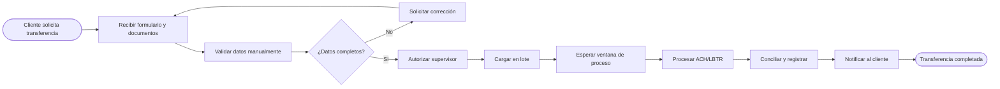
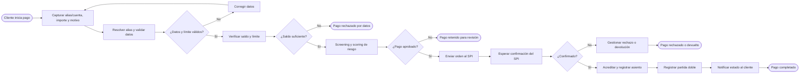
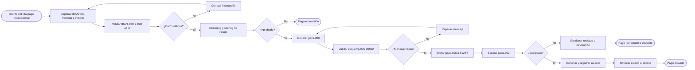
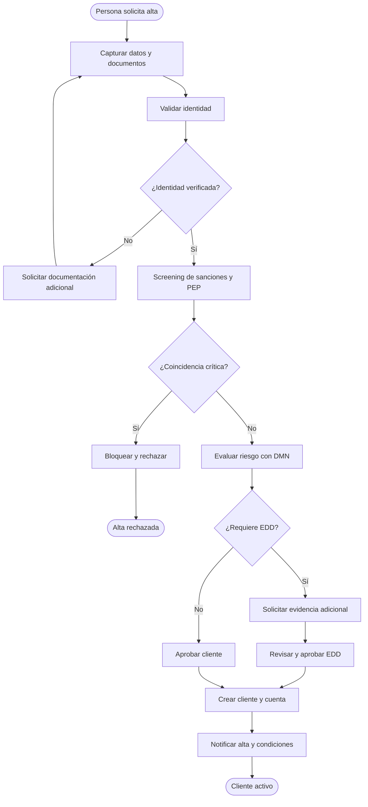
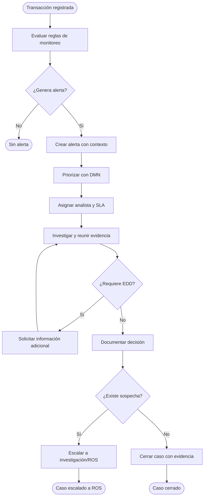
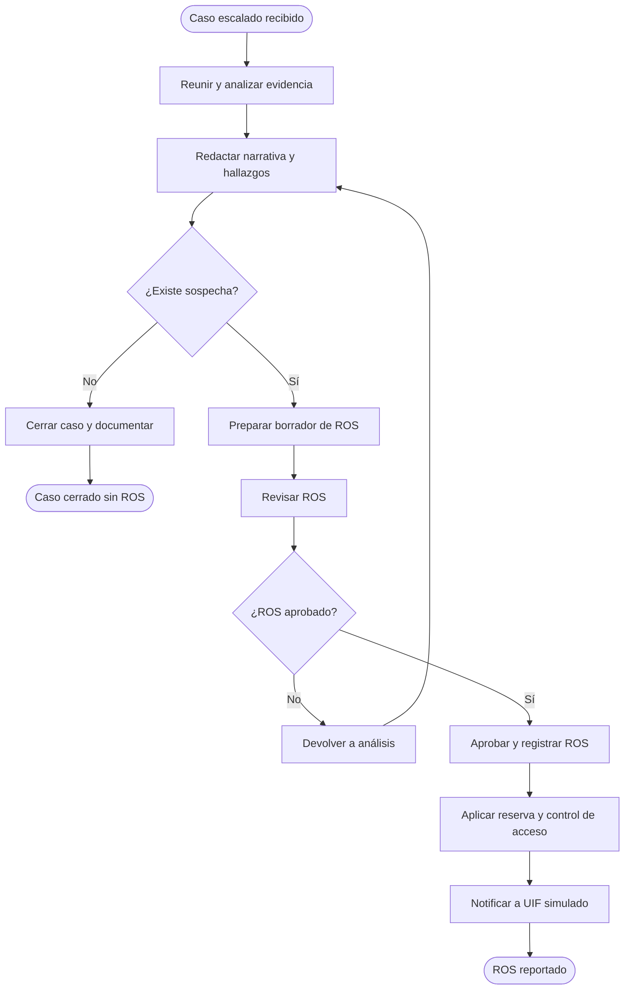
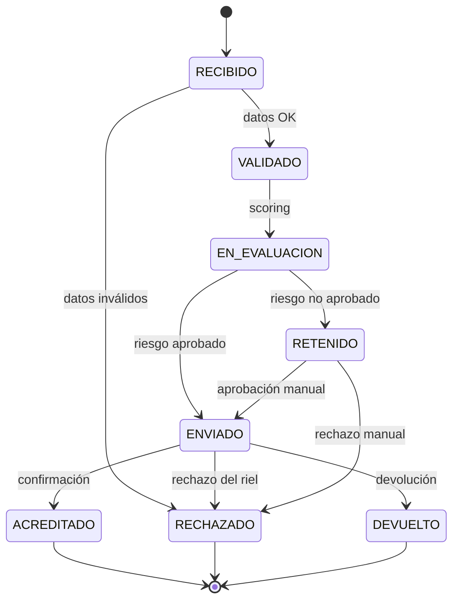
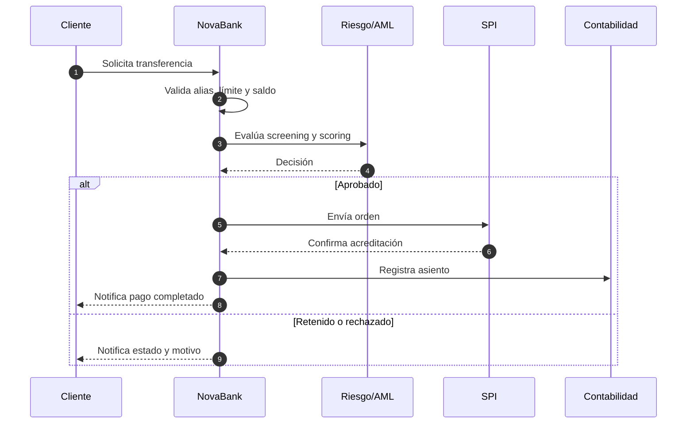
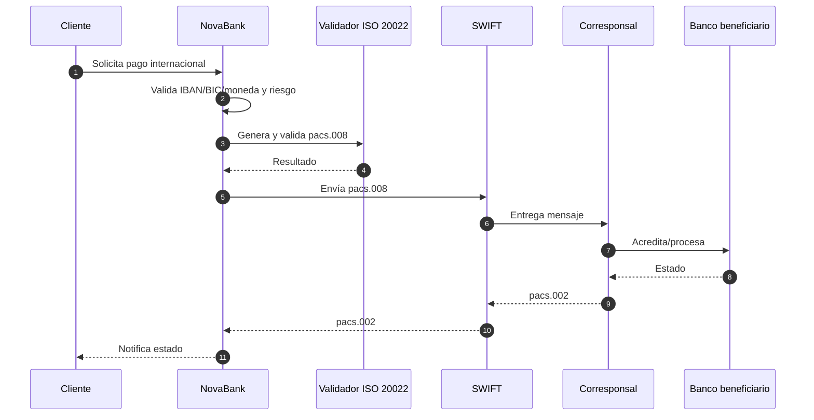
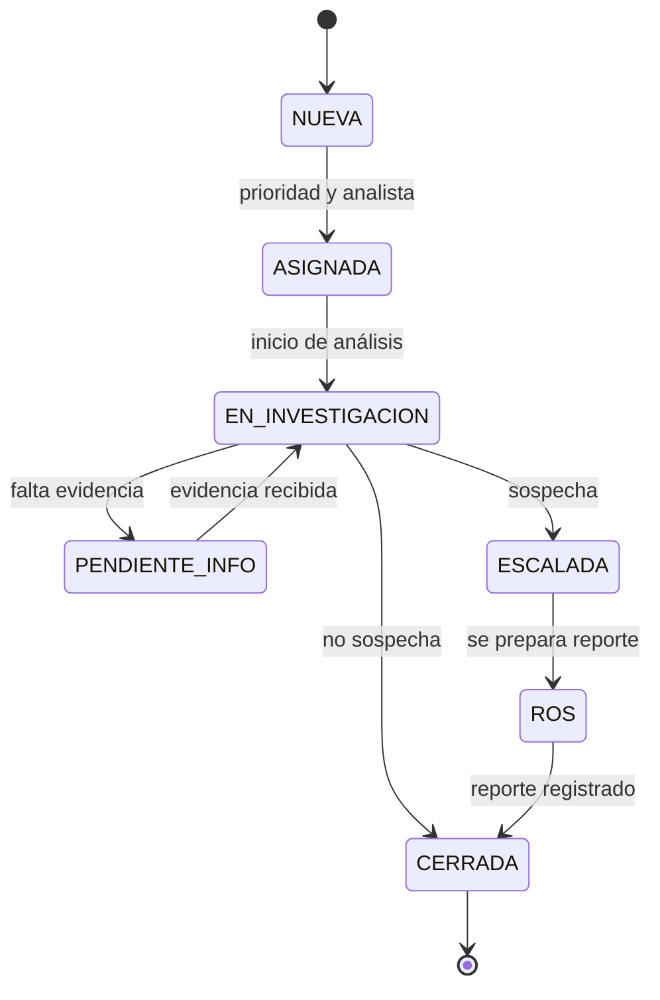

# Procesos en Mermaid

**Proyecto:** NovaBank Instant & Cross-Border Payments + AML Hub
**Documento:** MMD-NB-001
**Versión:** 1.0
**Fecha:** 2026-10-27

> Diagramas complementarios a los BPMN. Se pueden visualizar en GitHub, GitLab, VS Code o en la herramienta de diagramación preferida. Los BPMN son la fuente principal para importar en Bizagi/Camunda/Signavio; Mermaid es una vista rápida y portable.

---

## 1. Leyenda

| Forma | Uso |
|---|---|
| Rectángulo | Actividad o paso |
| Rombo | Decisión |
| Óvalo / estadio | Inicio o fin |
| Flecha | Flujo de secuencia |
| Flecha punteada | Mensaje o dependencia |
| Nota | Aclaración |

---

## 2. Transferencia local AS-IS

**Problemas visibles:** validación manual, autorización separada, proceso por lote, espera de ventana y conciliación posterior.

---

## 3. Transferencia local TO-BE

**Controles:** idempotencia por identificador, scoring antes de liberar, confirmación del SPI, asiento contable y notificación.

---

## 4. Transferencia internacional TO-BE

**Controles:** validación de IBAN/BIC/ISO 4217, screening previo, validación del esquema, correlación `pacs.008`/`pacs.002` y conciliación.

---

## 5. Onboarding y KYC

**Excepciones:** identidad no verificable, coincidencia en listas, PEP, beneficiario final incompleto y rechazo por riesgo.

---

## 6. Gestión de alerta AML

**SLA del caso:** P1 = 15 min para asignación; P2 = 60 min; P3 = 4 h. Son parámetros de diseño.

---

## 7. Investigación y ROS

**Control clave:** la reserva impide revelar al cliente que se reportó la operación.

---

## 8. Máquina de estados del pago

**Invariante:** un pago no puede pasar de `ACREDITADO` a `ENVIADO`; toda transición queda registrada.

---

## 9. Secuencia local TO-BE

---

## 10. Secuencia internacional TO-BE

---

## 11. Estado de una alerta AML

---

## 12. Notas de uso

- Los diagramas no reemplazan los BPMN; son vistas para comunicación.
- Si se edita un proceso, actualizar BPMN, Mermaid y `mapa-procesos.md`.
- Las etiquetas con acentos y signos de interrogación se muestran correctamente en UTF-8.
- Para exportar a PNG/SVG, usar la extensión Mermaid de VS Code o la vista de GitHub.
- No se declara que los diagramas hayan sido renderizados en una herramienta específica; la verificación visual es manual.
