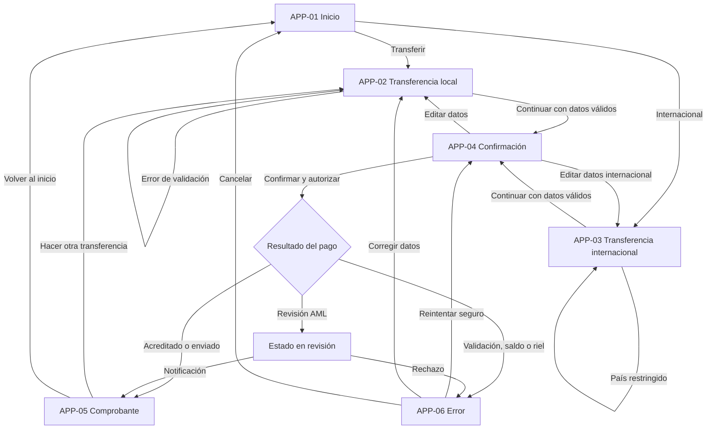
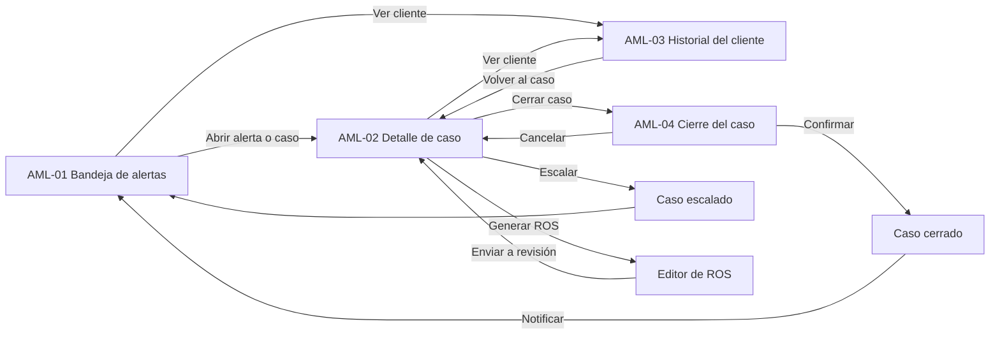

# Flujo del prototipo y componentes reutilizables

**Documento:** UX-NB-002
**Versión:** 1.0
**Fecha:** 2026-10-29

> Los enlaces del prototipo se definirán cuando el autor replique los wireframes en Figma o Balsamiq. Este documento describe la secuencia, los puntos de decisión y las conexiones que deben configurarse.

---

## 1. Flujo principal del cliente

### Puntos de decisión

| Nodo | Condición | Destino |
|---|---|---|
| Validación local | Alias/cuenta válidos, saldo suficiente, importe ≤ tope | APP-04 |
| Validación internacional | BIC/IBAN válidos, país permitido, saldo para importe + comisión | APP-04 |
| Resultado del pago | Estado `POSTED` | APP-05 |
| Resultado del pago | Estado `PENDING` por AML | Estado en revisión |
| Resultado del pago | Error de validación, saldo o riel | APP-06 |
| Reintento | Operación idempotente y no debitada | APP-04 |
| Reintento | Estado desconocido | APP-06 variante timeout |

---

## 2. Flujo de la consola de cumplimiento

### Reglas de navegación

1. La bandeja conserva filtros y paginación al volver desde el detalle.
2. El historial del cliente se abre en una pestaña nueva si el usuario lo solicita; si no, conserva el contexto del caso.
3. El cierre del caso es un modal sobre el detalle; al confirmar, el detalle se actualiza sin recargar toda la bandeja.
4. Las acciones no permitidas por estado o rol se ocultan, no solo se deshabilitan.
5. Todo enlace profundo debe poder abrirse en una sesión autenticada y respetar permisos.

---

## 3. Matriz de navegación

| Desde | Acción | Hacia | Condición |
|---|---|---|---|
| APP-01 | Transferir | APP-02 | Sesión activa |
| APP-01 | Internacional | APP-03 | Sesión activa |
| APP-02 | Continuar | APP-04 | Formulario válido |
| APP-03 | Continuar | APP-04 | Formulario válido y costos aceptados |
| APP-04 | Editar | APP-02 / APP-03 | Operación no enviada |
| APP-04 | Confirmar | APP-05 / APP-06 / revisión | Autorización correcta |
| APP-05 | Nueva transferencia | APP-02 | Sesión activa |
| APP-06 | Reintentar | APP-04 | Operación reintentable |
| AML-01 | Fila | AML-02 | Permiso de analista |
| AML-01 | Cliente | AML-03 | Permiso de analista |
| AML-02 | Cerrar caso | AML-04 | Caso abierto y asignado |
| AML-02 | Historial | AML-03 | Permiso de analista |
| AML-04 | Confirmar | AML-02 | Checklist y motivo válidos |

---

## 4. Componentes reutilizables

| Componente | Uso | Variantes | Estados | Notas de accesibilidad |
|---|---|---|---|---|
| `AppHeader` | App cliente | Con volver / sin volver | normal, sticky | Título como `h1`; botón volver con etiqueta accesible |
| `BalanceCard` | Inicio | PYG / USD | cargando, error, oculto | Importe con `aria-label` completo; no depender del color |
| `MoneyInput` | Formularios | PYG, USD, EUR | normal, foco, error, disabled | `inputmode="decimal"`; ayuda vinculada con `aria-describedby` |
| `AccountSelect` | Origen | PYG / USD / EUR | vacío, cargando, error | Etiqueta persistente; muestra cuenta enmascarada |
| `RecipientResolver` | Destinatario | Alias / cuenta / IBAN | idle, resolving, valid, invalid | Anunciar resultado con `role="status"` |
| `SummaryCard` | Confirmación | Local / internacional | normal, revisión AML | Lista de definición (`dl`) semántica |
| `StatusBanner` | Avisos | info, success, warning, error | estático | `role="status"` o `role="alert"` según urgencia |
| `PrimaryButton` | Acciones | filled, destructive | normal, hover, focus, loading, disabled | Altura mínima 44 px; foco visible |
| `SecondaryButton` | Acciones | outline, ghost | normal, focus, disabled | No usar solo ícono sin texto |
| `Stepper` | Progreso | 2–4 pasos | actual, completado, pendiente | `aria-current="step"` |
| `AlertTable` | Bandeja AML | compacta / cómoda | cargando, vacío, error, selección | Tabla semántica, encabezados `th`, orden anunciado |
| `PriorityBadge` | Alertas | P1/P2/P3 | estático | Texto + color + ícono |
| `SlaCountdown` | Alertas y casos | vencido / próximo / en plazo | dinámico | Texto completo, `aria-live="polite"` solo si cambia |
| `CaseTimeline` | Detalle | vertical | normal | Lista ordenada (`ol`) |
| `InvestigationNote` | Detalle | edición / lectura | guardando, error | Contador de caracteres accesible |
| `CloseCaseDialog` | Cierre | falso positivo / escalar / reportar | validando, guardando, error | Modal con foco atrapado y cierre con `Esc` |
| `FilterBar` | Bandeja / historial | simple / avanzada | abierta, colapsada | Botón “Aplicar filtros”; no aplicar solo con cambio de foco |
| `EmptyState` | Global | sin datos, sin resultados, sin permiso | estático | Título, explicación y acción |
| `Toast` | Global | éxito, error, información | auto-cierre | `role="status"`; no robar foco; pausa al pasar el cursor |

---

## 5. Conexiones del prototipo en Figma/Balsamiq

1. Crear un frame por pantalla con el nombre exacto del ID (`APP-01`, etc.).
2. Usar componentes maestros para `PrimaryButton`, `StatusBanner`, `MoneyInput`, `PriorityBadge` y `AlertTable`.
3. Configurar las conexiones de la sección 3 como “On click”.
4. Para APP-04, crear prototipo con estados: `listo`, `autorizando`, `error` y `revisión`.
5. Para AML-04, usar overlay modal y configurar el retorno al frame AML-02.
6. Agregar notas de interacción con las condiciones de la sección 3; no conectar acciones no permitidas.
7. Probar el recorrido completo con teclado y con lector de pantalla antes de compartir.
