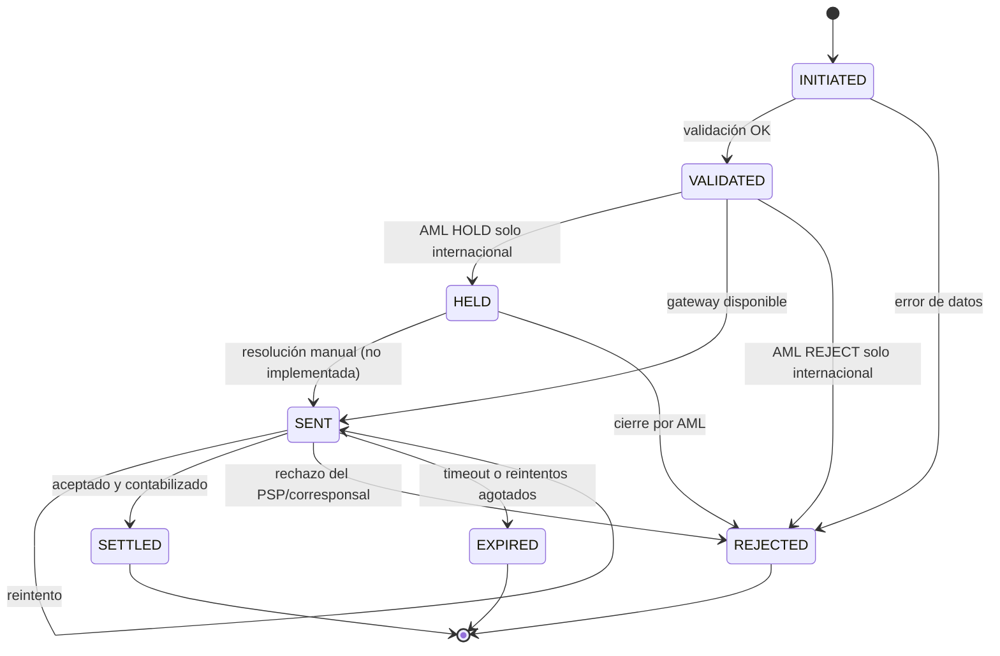
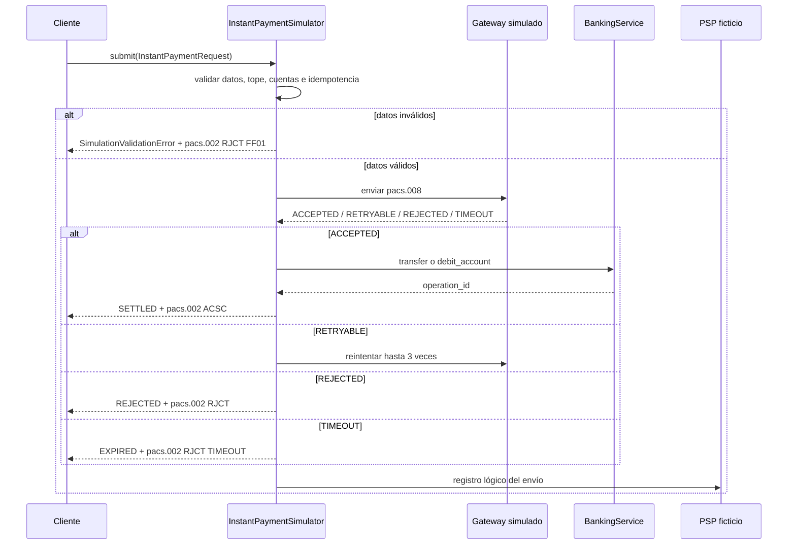
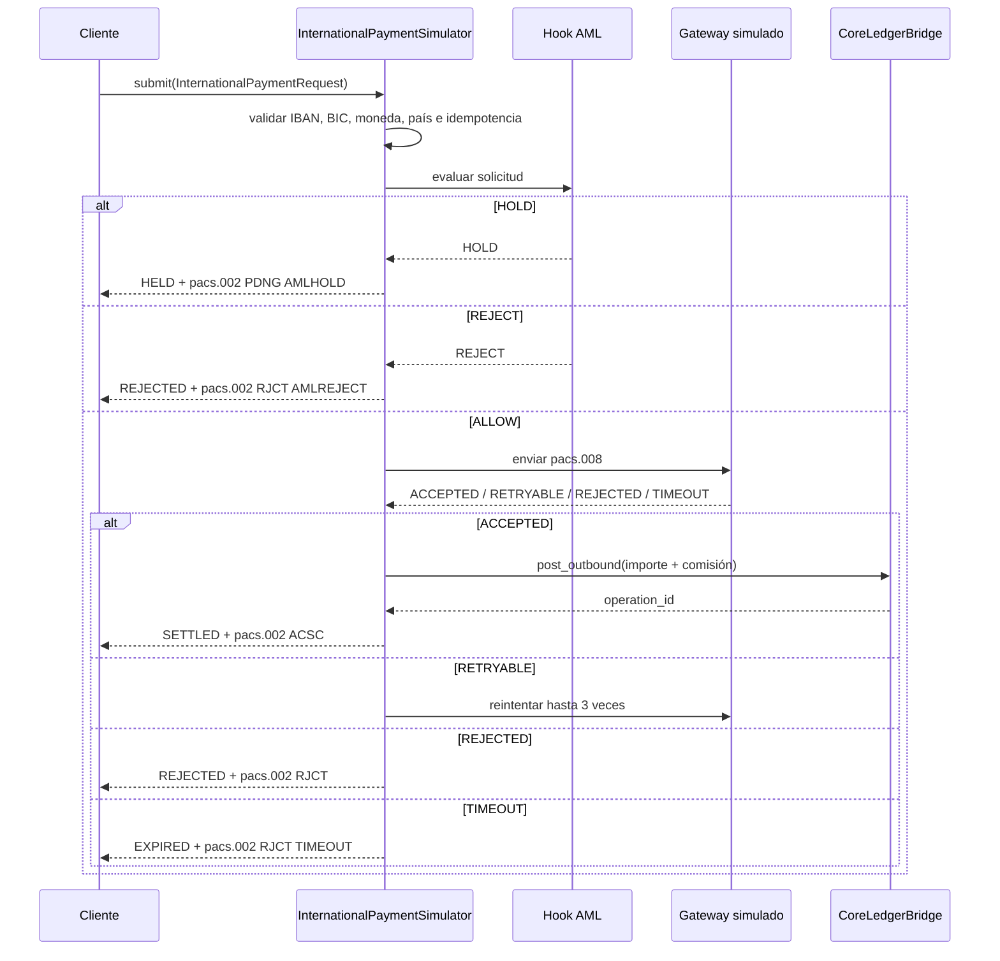

# Simuladores de pago

**Propósito:** demostrar el ciclo funcional de un pago local y otro internacional con máquina de estados, idempotencia, reintentos, mensajes ISO 20022 y posteo contable en el core de Fase 3.

> Los simuladores son deterministas y operan en proceso. No se conectan al SPI del BCP, a SWIFT ni a un core productivo (S-059).

## Máquina de estados



Diagrama: [`diagrams/estado-pago.mmd`](../diagrams/estado-pago.mmd).

## Simulador instantáneo local

Archivo: `simulator/instant.py`.

| Regla | Valor |
|---|---|
| Moneda | PYG |
| Tope por operación | ₲10.000.000 (inclusive) |
| Reintentos máximos | 3 |
| Idempotencia | Obligatoria; 8–128 caracteres `[A-Za-z0-9._:-]` |
| Destino | `creditor_account_id` interno, alias o número de cuenta |
| Liquidación | Transferencia interna o débito a cuenta externa en el core |
| Mensajes | `pacs.008` al enviar; `pacs.002` con `ACSC` o `RJCT` |
| Cargo | `SLEV` en el mensaje local |

Flujo:



Diagrama: [`diagrams/flujo-instantaneo.mmd`](../diagrams/flujo-instantaneo.mmd).

## Simulador internacional

Archivo: `simulator/international.py`.

| Regla | Valor |
|---|---|
| Moneda liquidable | USD (EUR se valida pero no se postea, S-061) |
| Cuenta destino | IBAN válido |
| BIC destino | Obligatorio, ISO 9362 |
| Comisión | `fee`, por defecto USD 25.00; configurable (S-062) |
| Débito | Importe + comisión |
| Reintentos máximos | 3 |
| AML | Hook simulado `ALLOW`, `HOLD` o `REJECT` (S-063) |
| Mensajes | `pacs.008` internacional y `pacs.002` |
| Agentes | `DbtrAgt` = `NOVAPYPA`; `CdtrAgt` = BIC del beneficiario |

Flujo:



Diagrama: [`diagrams/flujo-internacional.mmd`](../diagrams/flujo-internacional.mmd).

## Posteo contable internacional

`CoreLedgerBridge.post_outbound` usa partida doble en el libro mayor del core:

| Cuenta | Débito | Crédito |
|---|---|---|
| `2102` — depósitos de clientes USD | Importe + comisión | — |
| `1102` — efectivo/corresponsal USD | — | Importe |
| `4102` — ingresos por comisiones USD | — | Comisión |

Además registra la transacción, la comisión y el evento de auditoría. Si el saldo no alcanza para importe + comisión, rechaza con `AM04` y no postea.

## Idempotencia y errores

- La misma `idempotency_key` con el mismo contenido devuelve el registro original.
- La misma clave con contenido distinto lanza `IdempotencyConflict`.
- Un `instruction_id` duplicado en memoria lanza `ValueError`.
- Los rechazos de gateway usan `GatewayOutcome` y quedan en `SimulationRecord`.
- Los timeouts se representan con el motivo propietario `TIMEOUT`; no se afirma que sea un código SWIFT.

## Ejemplo de uso

```python
from decimal import Decimal
from app.service import BankingService
from simulator.international import InternationalPaymentSimulator
from simulator.models import InternationalPaymentRequest

service = BankingService(db_path="05-core-middleware/db/novabank.db")
simulator = InternationalPaymentSimulator(service)
record = simulator.submit(InternationalPaymentRequest(
    instruction_id="INTL-2026-0001",
    debtor_account_id="ACC-USD-001",
    creditor_name="JOHN DEMO",
    creditor_iban="DE89370400440532013000",
    creditor_bic="NOVBDEFF",
    amount=Decimal("100.00"),
    fee=Decimal("25.00"),
    charge_bearer="SHA",
    idempotency_key="idem-intl-0001",
))
print(record.state, record.operation_id)
```

Los ejemplos concretos de XML están en [`examples/iso20022/`](../examples/iso20022/).
