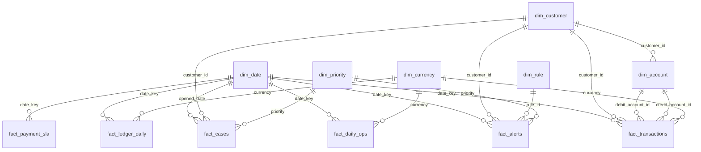

# Especificación del tablero analítico

**Documento:** AN-NB-003
**Versión:** 1.0
**Fecha:** 2026-10-29
**Herramientas objetivo:** Power BI Desktop / Power BI Service y Tableau Public.
**Fuente:** `09-analitica/data/*.csv` y modelo estrella de `09-analitica/powerbi/medidas.dax`.

---

## 1. Objetivo

Dar una vista única, en tres capas, del negocio de pagos y cumplimiento:

1. **Operaciones y volumen:** cuánto se mueve, por dónde y con qué ticket.
2. **SLA de pagos instantáneos:** si la promesa local se cumple y dónde se degrada.
3. **Alertas AML y falsos positivos:** cuánto riesgo se detecta, cuánto se cierra y con qué calidad.

La cuarta página es opcional y sirve para casos, ROS y conciliación.

## 2. Audiencias y preguntas

| Audiencia | Pregunta principal | Página |
|---|---|---|
| Comité de dirección | ¿Crece el volumen y se sostiene la calidad? | Operaciones |
| Producto / operaciones | ¿El pago instantáneo cumple el SLA? | SLA |
| Compliance | ¿Las alertas P1 se atienden y los falsos positivos bajan? | AML |
| Auditoría / riesgos | ¿Los casos se cierran y el libro cuadra? | Casos y conciliación |

## 3. Modelo de datos



- `dim_date` es la única tabla de fechas y debe estar marcada como **Date table**.
- `dim_account` tiene dos relaciones hacia `fact_transactions`: débito activa, crédito inactiva. Las medidas de saldo por cuenta usan `USERELATIONSHIP`.
- `fact_cases` no se relaciona directamente con `fact_alerts` para evitar ambigüedad de rutas; se analiza como hecho independiente. Para el detalle alerta→caso se usa el campo degenerado `case_id` o una página de detalle.
- `fact_cases` se relaciona con `dim_date` mediante una fecha de apertura derivada (`opened_date`). Si no se crea, usar `opened_at` con una relación inactiva y `USERELATIONSHIP`.

## 4. Páginas y visuales

### 4.1 Página 1 — Operaciones y volumen

**Objetivo:** explicar el crecimiento y la mezcla del negocio.

| Zona | Visual | Campos / medidas |
|---|---|---|
| Cabecera | 5 tarjetas KPI | `Total Operations`, `Total Amount PYG`, `Total Amount USD`, `Avg Ticket PYG`, `Operations MoM %`. |
| Fila 2 izquierda | Línea | Eje `dim_date[year_month]`; valores `Total Amount PYG` y `Total Amount USD`. |
| Fila 2 derecha | Columnas apiladas | Eje `dim_date[year_month]`; leyenda `payment_scope`; valor `Total Operations`. |
| Fila 3 izquierda | Barras horizontales | `dim_customer[segment]`; `Total Amount`. |
| Fila 3 centro | Anillo | `fact_transactions[transaction_type]`; `Total Operations`. |
| Fila 3 derecha | Matriz | Filas `segment`, columnas `currency`; `Total Amount`, `Avg Ticket PYG`, `STP Rate (proxy)`. |
| Pie | Nota | Fuente sintética y fecha de corte. |

**Filtros:** rango de `dim_date[date_key]`, `currency`, `segment`, `payment_scope`, `channel`.
**Interacción:** la línea y el anillo filtran la matriz; el resto queda con interacción cruzada activa.

### 4.2 Página 2 — SLA de pagos instantáneos

**Objetivo:** monitorear la promesa de 5 segundos y detectar canales/segmentos con degradación.

| Zona | Visual | Campos / medidas |
|---|---|---|
| Cabecera | 4 tarjetas | `Local Payments`, `Local p95 Latency (ms)`, `Payments Within SLA %`, `Payments Outside SLA`. |
| Fila 2 izquierda | Línea | `dim_date[date_key]`; `Local p95 Latency (ms)` y `Local Avg Latency (ms)`. |
| Fila 2 derecha | Columnas 100 % apiladas | `dim_date[year_month]`; leyenda `within_sla`; `Local Payments`. |
| Fila 3 izquierda | Barras | `channel`; `Payments Within SLA %`; línea de referencia en 95 %. |
| Fila 3 centro | Histograma | `Latency Bin`; `Local Payments`. |
| Fila 3 derecha | Tarjeta de estado | `SLA Status` con color verde/rojo. |
| Pie | Nota | Latencia sintética: no es una medición del core. |

**Filtros:** fecha, `channel`, `segment`, `currency` (solo PYG en este hecho).
**Umbral:** 5.000 ms (`Param_SLA_Instantaneo_ms` en Excel; en Power BI parámetro `SLA objetivo`).

**Columna calculada necesaria:**

```dax
Latency Bin =
VAR ms = fact_payment_sla[latency_ms]
RETURN
    SWITCH (
        TRUE (),
        ms < 1000, "< 1 s",
        ms < 2000, "1–2 s",
        ms < 3000, "2–3 s",
        ms < 5000, "3–5 s",
        "> 5 s"
    )
```

Ordenar `Latency Bin` por una columna numérica auxiliar (`Latency Bin Order`) para que el histograma respete la secuencia.

### 4.3 Página 3 — Alertas AML y falsos positivos

**Objetivo:** ver carga, prioridad, oportunidad y calidad de cierre.

| Zona | Visual | Campos / medidas |
|---|---|---|
| Cabecera | 6 tarjetas | `Total Alerts`, `Open Alerts`, `P1 Alerts`, `P1 Assigned On Time %`, `False Positive Rate`, `Avg Alert Risk Score`. |
| Fila 2 izquierda | Columnas | `dim_rule[rule_id]`; `Total Alerts`; color por severidad. |
| Fila 2 derecha | Columnas 100 % apiladas | `dim_date[year_month]`; leyenda `status`; `Total Alerts`. |
| Fila 3 izquierda | Dispersión | X `assignment_minutes`, Y `risk_score`, detalles `alert_id`; tamaño `transaction_count`; leyenda `priority`. |
| Fila 3 centro | Matriz | Filas `segment`, columnas `risk_rating`; `Total Alerts`, `False Positive Rate`. |
| Fila 3 derecha | Embudo | `Total Alerts` → `Escalated Alerts` → `Total Cases` → `Reported Cases`. |
| Pie | Nota | Ciclo de vida sintético para demostración. |

**Filtros:** fecha, `priority`, `status`, `rule_id`, `segment`, `risk_rating`.
**Alertas visuales:** P1 en rojo; `Open Alerts` con umbral; tasa de falsos positivos con meta de 30 %.

### 4.4 Página 4 — Casos y conciliación (opcional)

| Zona | Visual | Campos / medidas |
|---|---|---|
| Cabecera | 4 tarjetas | `Total Cases`, `Closed Cases`, `Cases On Time %`, `Reported Cases`. |
| Izquierda | Columnas | `dim_date[year_month]`; `Total Cases`, `Closed Cases`. |
| Centro | Barras | `priority`; `Cases On Time %`. |
| Derecha | Tarjeta / KPI | `Reconciliation Difference`, `Reconciliation Status`. |
| Abajo | Tabla | `date_key`, `currency`, `debit`, `credit`, `Reconciliation Difference`. |

## 5. Filtros globales

| Filtro | Tipo | Ubicación | Comportamiento |
|---|---|---|---|
| Fecha | Rango | Todas las páginas | Sincronizado; por defecto últimos 90 días. |
| Moneda | Lista | Operaciones y conciliación | No aplica a SLA (solo PYG). |
| Segmento | Lista | Todas | Afecta clientes, cuentas y hechos. |
| Canal | Lista | Operaciones y SLA | No afecta alertas si el campo no existe en el hecho. |
| Prioridad | Botones | AML | P1/P2/P3 con “Todas”. |
| Estado | Lista | AML | Nuevas, en análisis, escaladas, cerradas, reportadas. |

Reglas:

- Sincronizar solo fecha y segmento entre páginas; el resto queda local.
- Evitar filtros que oculten el 100 % de un visual sin mensaje.
- Usar “Restablecer filtros” visible.
- Los filtros deben mostrar selección actual y cantidad.

## 6. Diseño visual

| Elemento | Regla |
|---|---|
| Paleta | Azul NovaBank `#0B3B60`, azul de acción `#1F6FB2`, verde `#2E7D32`, ámbar `#ED6C02`, rojo `#C62828`, gris `#5F6B7A`, fondo `#F7F9FC`. |
| Tipografía | Segoe UI; títulos 14–16 px, KPI 28–32 px, textos 10–12 px. |
| Grilla | 12 columnas, márgenes de 16 px, separación de 8 px. |
| Tarjetas KPI | Título corto, valor grande, variación y meta; sin borde pesado. |
| Colores semánticos | Verde solo para cumplimiento; rojo solo para incumplimiento o P1; no usar rojo decorativo. |
| Accesibilidad | Contraste ≥ 4,5:1; no depender solo del color; etiquetas de datos en visuales clave; orden de tabulación lógico; texto alternativo en cada visual. |
| Densidad | Máximo 6–8 visuales por página; una idea por página. |
| Formatos | Moneda PYG sin decimales, USD/EUR con dos; porcentajes con un decimal; miles con separador. |
| Tooltips | Incluir período, moneda, operaciones, importe y tasa. |
| Móvil | Vista móvil con 4 tarjetas y un gráfico principal por página. |

## 7. Criterios de aceptación

- [ ] Las 3 páginas requeridas abren sin errores y con datos.
- [ ] Los KPI coinciden con el workbook Excel y con `export_report.json`.
- [ ] `dim_date` marcada como tabla de fechas; jerarquía año/trimestre/mes/día.
- [ ] Al menos 15 medidas DAX documentadas y utilizadas.
- [ ] Filtros sincronizados según la matriz.
- [ ] SLA y alertas muestran notas de datos sintéticos.
- [ ] Contraste y etiquetas cumplen la checklist de accesibilidad.
- [ ] Se exportó PDF o captura como evidencia y se registró en `docs/EVIDENCIAS.md`.
