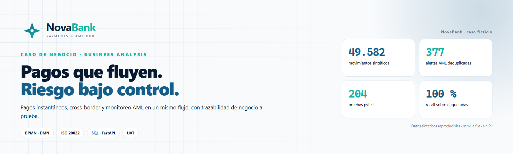
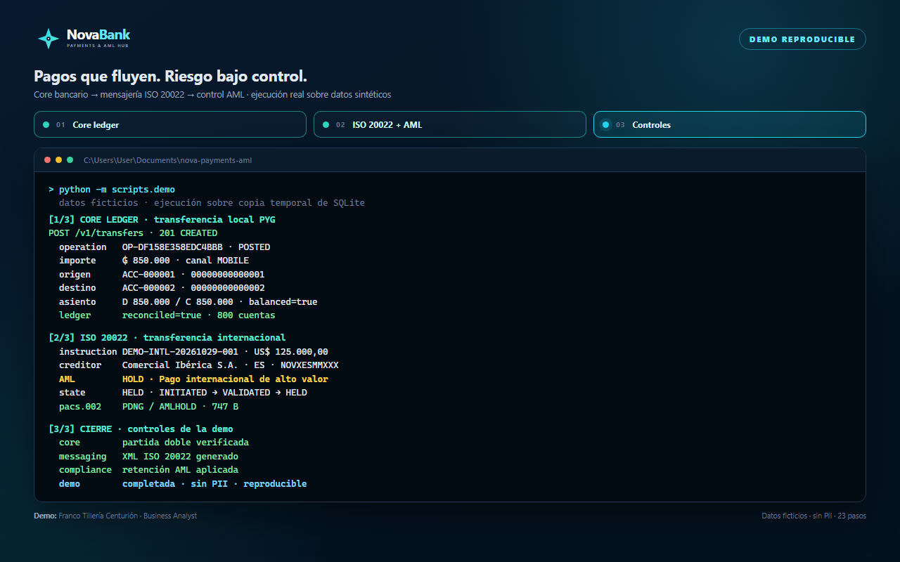
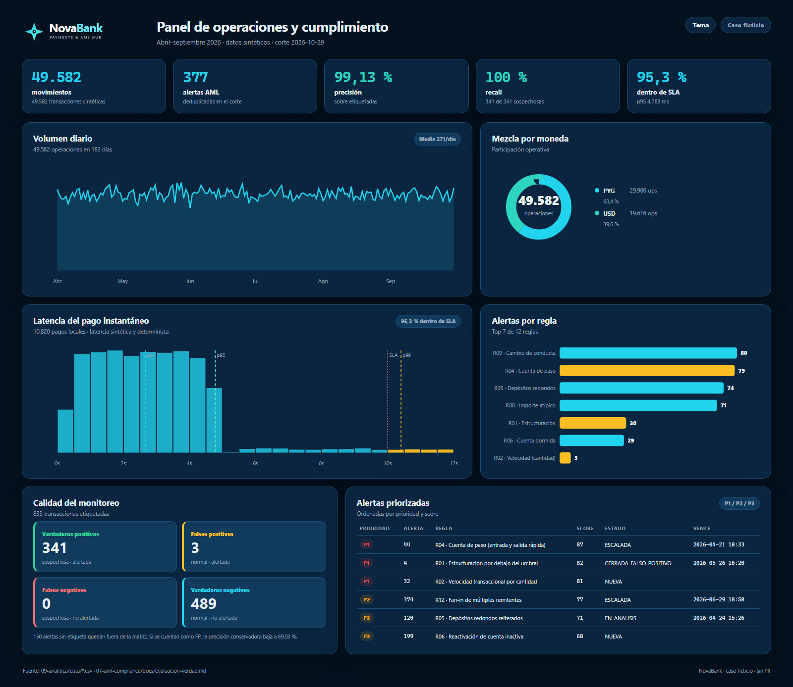
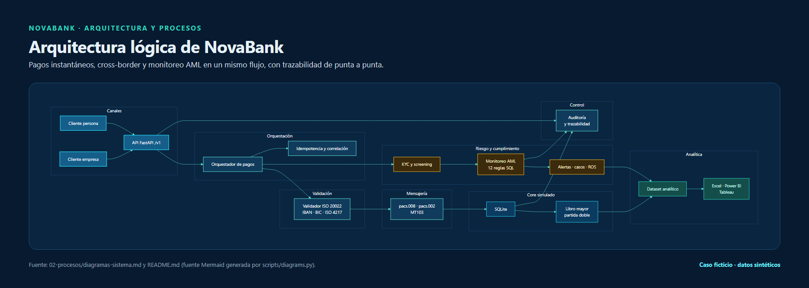
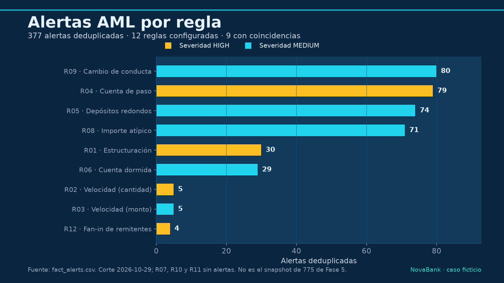
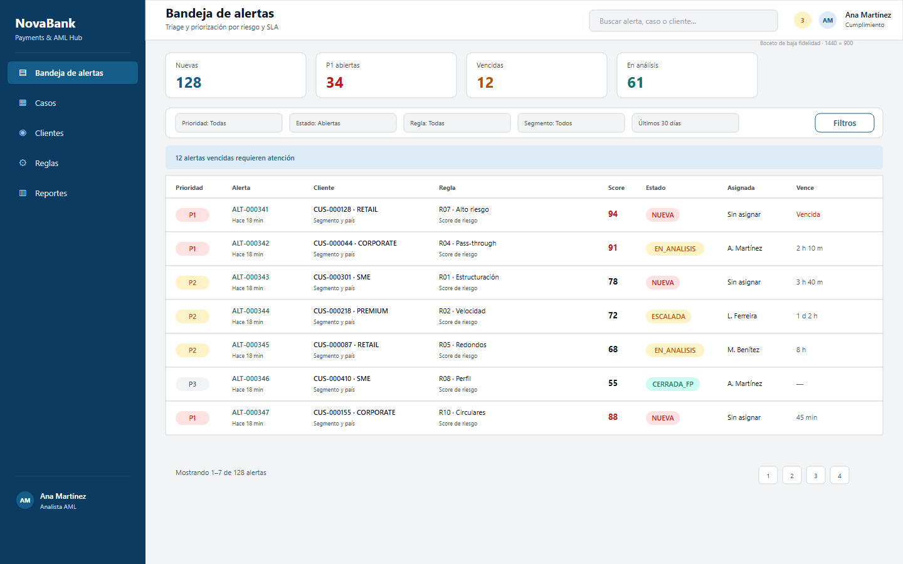
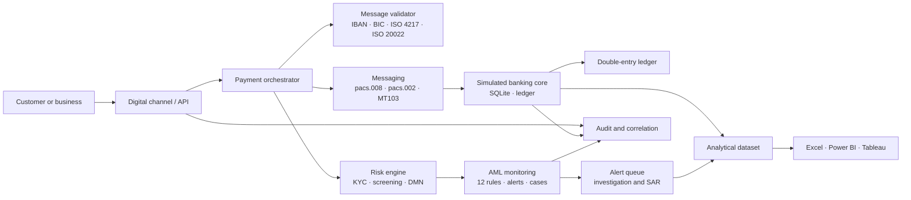

<p align="center">
  <picture>
    <source media="(prefers-color-scheme: dark)" srcset="docs/assets/img/banner-dark.png">
    
  </picture>
</p>

<h1 align="center">NovaBank — Instant &amp; Cross-Border Payments + AML Hub</h1>

<p align="center"><b>End-to-end portfolio case · Business Analysis · Payments · AML</b></p>

<p align="center">
  
  
  
  
  
  
</p>

<p align="center">
  <b>Franco Tillería Centurión</b> · Business Analyst · Asunción, Paraguay<br>
  <a href="https://www.linkedin.com/in/franco-tilleria-centurion/">LinkedIn</a> ·
  <a href="https://github.com/Vaxilium">GitHub</a> ·
  <a href="https://github.com/Vaxilium/nova-payments-aml">Repository</a> ·
  <a href="README.md">Versión en español</a>
</p>

> **Entirely fictional case.** NovaBank, its customers, accounts, BIC and IBAN are
> invented. No confidential information from real employers or institutions is used.
>
> [Case study](docs/case-study.md) · [Interview guide (ES)](docs/entrevista.md) · [Truth audit (ES)](docs/AUDITORIA.md) · [Evidence (ES)](docs/EVIDENCIAS.md) · [LinkedIn carousel](docs/assets/linkedin/carousel-novabank.pdf)

## Executive summary

NovaBank is a fictional Paraguayan bank launching instant domestic transfers
(inspired by the BCP's SPI) and cross-border payments over SWIFT/ISO 20022, with
AML monitoring and compliance embedded end to end. This repository documents the
full Business Analysis lifecycle: discovery, process modeling, requirements,
core/middleware design, messaging validation, AML rules, UAT and analytics.

It is a public portfolio built to demonstrate practical BA tools and banking
domain knowledge on a realistic but entirely synthetic scenario. The project is
complete at artifact level across nine delivery phases. It includes 10 epics and
40 user stories with Gherkin acceptance criteria, 6 BPMN processes, 4 DMN
decision tables, a tested SQLite core with double-entry accounting, a FastAPI
`/v1` service, ISO 20022/MT103 validators and simulators, 12 AML monitoring
rules, a synthetic dataset, an 11-sheet Excel workbook, Power BI/Tableau
specifications, and a UAT pack with 65 test cases. Phase 9 adds a reproducible
visual system: brand assets, banners, diagrams, charts, a dashboard, wireframes,
a technical demo GIF, a LinkedIn carousel and a GitHub Pages site.

Latest reproducible results (2026-10-29, fresh clone, local Windows environment):

- **204/204 pytest tests passing** across core, messaging, AML and analytics.
- **51/51 automated UAT cases approved**; 6 cases remain pending manual execution
  and 8 are declared as not implemented in the prototype.
- **23/23 SQL control queries OK**; `PRAGMA integrity_check = ok`; 0 foreign-key
  violations.
- **5 open defects** documented, including a critical security gap: the
  prototype API has no authentication or role-based authorization.
- **40/40 user stories traced** to at least one test case.

The automated evidence is real and reproducible. Evidence for Jira, Confluence,
Azure DevOps, Figma/Balsamiq, Power BI, Tableau, Camunda and LinkedIn **requires
manual execution by the author** and is tracked in
[`docs/EVIDENCIAS.md`](docs/EVIDENCIAS.md). Every claim in this README was
audited in [`docs/AUDITORIA.md`](docs/AUDITORIA.md).

<p align="center">
  <a href="#the-problem">Problem</a> ·
  <a href="#the-solution">Solution</a> ·
  <a href="#reproducible-demo">Demo</a> ·
  <a href="#visual-gallery">Gallery</a> ·
  <a href="#key-results-real-metrics">Results</a> ·
  <a href="#how-to-run-the-project">Run</a> ·
  <a href="#what-it-demonstrates-and-what-it-does-not">Limits</a>
</p>

## At a glance

| Dimension | Reproducible result |
|---|---|
| Business and requirements | 10 epics · 40 Gherkin stories · 16 NFRs · 198 SP |
| Processes and decisions | 6 BPMN · 4 DMN · 10 wireframes |
| Core and messaging | SQLite double-entry ledger · FastAPI `/v1` · ISO 20022/MT103 |
| AML | 12 SQL rules · 377 deduplicated alerts · 59 cases |
| Quality | 204/204 tests · 51/51 automated UAT · 23/23 SQL controls |
| Presentation | Dashboard · demo GIF · LinkedIn carousel · GitHub Pages |

## Reproducible demo

<p align="center">
  <a href="docs/assets/img/demo.gif">
    
  </a>
</p>

The demo runs a real local transfer against a **temporary SQLite copy**, shows the
double-entry posting and an AML hold for a high-value international payment. It
does not modify the repository database and uses no PII.

```powershell
python -m pip install -r requirements-assets.txt
python -m scripts.demo
```

Output: [`docs/assets/img/demo.gif`](docs/assets/img/demo.gif) · source
[`docs/assets/src/demo.html`](docs/assets/src/demo.html) · script
[`scripts/demo.py`](scripts/demo.py).

## Visual gallery

<table>
  <tr>
    <td width="50%">
      <a href="docs/assets/dashboard/index.html"></a>
      <sub><b>Operations dashboard</b> · KPIs, SLA, alerts and AML quality · <a href="docs/assets/dashboard/index.html">interactive HTML</a></sub>
    </td>
    <td width="50%">
      <a href="docs/assets/img/architecture.png"></a>
      <sub><b>Architecture</b> · from channel to ledger · <a href="02-procesos/diagramas-sistema.md">full view (ES)</a></sub>
    </td>
  </tr>
  <tr>
    <td width="50%">
      <a href="docs/assets/img/chart-alerts-by-rule.png"></a>
      <sub><b>AML monitoring</b> · 377 deduplicated alerts · <a href="07-aml-compliance/docs/reglas-monitoreo.md">12 rules (ES)</a></sub>
    </td>
    <td width="50%">
      <a href="docs/assets/img/ux/ux-aml-inbox.png"></a>
      <sub><b>UX</b> · 10 app and AML console wireframes · <a href="docs/assets/ux/index.html">gallery</a></sub>
    </td>
  </tr>
</table>

More: [dashboard](docs/assets/dashboard/index.html) ·
[UX gallery](docs/assets/ux/index.html) ·
[charts](docs/assets/img/) ·
[demo GIF](docs/assets/img/demo.gif) ·
[LinkedIn carousel (PDF)](docs/assets/linkedin/carousel-novabank.pdf).

## The problem

A mid-sized Paraguayan bank needs to compete in payments without multiplying
operational and compliance risk:

1. Customers expect instant, 24/7 domestic transfers with visible status and no
   branch visit.
2. International payments require ISO 20022/SWIFT messaging, identifier
   validation and compliance checks before funds are released.
3. Compliance needs KYC, screening, transaction monitoring, prioritized alerts,
   investigable cases and suspicious activity reports.
4. Operations needs accounting reconciliation, traceability and dashboards to
   detect deviations.
5. The business needs a traceable story from objective to test, not a collection
   of isolated documents.

## The solution

| Phase | What it solves | Main deliverables |
|---|---|---|
| 0 — Setup | Repository governance | `AGENTS.md`, `PLAN.md`, governance docs |
| 1 — Business & process | Understand the problem and regulatory context | BRD, RACI, risks, KPIs, glossary, 6 BPMN, 4 DMN, C4/ER/journeys |
| 2 — Requirements | Turn the business into a traceable backlog | 10 epics, 40 stories, 16 NFRs, 2 sprints, Jira/ADO CSV, Confluence kit, ADRs and RAID |
| 3 — Core & middleware | Demonstrate accounting and API | SQLite with triggers, ledger, reproducible seed, 23 queries, FastAPI `/v1`, OpenAPI |
| 4 — Messaging | Validate and simulate payments | ISO 20022 catalogue, MT103↔pacs.008 mapping, validator, local and international simulators |
| 5 — AML & compliance | Demonstrate KYC, screening and monitoring | Scoring, 12 SQL rules, fuzzy screening, alerts, cases, SLAs, fictional SARs, SEPRELAD/FATF mapping |
| 6 — UX & analytics | Show screens and analytical capability | 10 wireframes, UX specs, 12 CSVs, Excel, Power Query, 36 DAX measures, Tableau guide |
| 7 — QA/UAT & close | Verify and communicate | Strategy, UAT plan, 65 cases, defects, pipelines, README and LinkedIn drafts |
| 8 — Audit & hardening | Verify claims and package the portfolio | Truth audit, clean-clone test, security review, English README, case study, interview guide |
| 9 — Visual portfolio | Make the case visible and reproducible | Brand, banners, diagrams, charts, dashboard, UX, demo GIF, carousel and GitHub Pages |

## Logical architecture



Full context, container, entity and journey views are in
[`02-procesos/diagramas-sistema.md`](02-procesos/diagramas-sistema.md) and the
[visual recreation guide](02-procesos/guia-lucidchart-visio-miro.md).

## Demonstrated tools

> Real repository status. The project does not claim to have operated a tool the
> agent did not run. Manual evidence lives in `docs/EVIDENCIAS.md`.

| Capability | Tool | Artifact in the repository | Real status |
|---|---|---|---|
| Business analysis | BRD / RACI / risks / KPIs | [`01-negocio/`](01-negocio/) | Complete |
| Process modeling | Bizagi / Camunda / Signavio | 6 `.bpmn` in [`02-procesos/bpmn/`](02-procesos/bpmn/) | Well-formed XML; tool import requires manual execution (EV-004) |
| Decision modeling | DMN (Camunda / Signavio) | 4 `.dmn` in [`02-procesos/dmn/`](02-procesos/dmn/) | Well-formed XML; tool execution requires manual execution (EV-004) |
| Diagramming | Lucidchart / Visio / Miro | Mermaid, C4, ER and [guide](02-procesos/guia-lucidchart-visio-miro.md) | Artifacts ready; manual recreation pending (EV-005) |
| Backlog management | Jira | [`jira_import.csv`](03-requerimientos/jira_import.csv) + [guide](03-requerimientos/guia-importacion-jira.md) | Artifact ready; manual import pending (EV-001) |
| Documentation | Confluence | [Space kit](03-requerimientos/confluence/README.md) | Artifact ready; manual publishing pending (EV-002) |
| Work management & CI | Azure DevOps | [Work item CSV](03-requerimientos/ado_import/README.md) + [`azure-pipelines.yml`](08-qa-uat/azure-pipelines.yml) | Artifacts ready; manual import and run pending (EV-003, EV-009) |
| Data and queries | SQL (SQLite) | [23 queries](05-core-middleware/sql/README.md), schema and AML rules | Implemented and tested |
| Requirements modeling | Stories / Gherkin | [40 stories](03-requerimientos/historias-usuario.md), NFRs, DoR/DoD, [traceability](03-requerimientos/matriz-trazabilidad.csv) | Complete |
| Screen design | Balsamiq / Figma | [Specs](04-diseno-ux/especificacion-pantallas.md), 10 wireframes and [flow](04-diseno-ux/flujo-prototipo.md) | Artifacts ready; manual recreation pending (EV-006) |
| Advanced Excel | Microsoft Excel | [`NovaBank_analitica.xlsx`](09-analitica/excel/NovaBank_analitica.xlsx) + [docs](09-analitica/docs/excel.md) | Generated and tested |
| BI modeling | Power BI | [36 DAX measures](09-analitica/powerbi/medidas.dax) + [guide](09-analitica/powerbi/README.md) | Artifact ready; `.pbix` and publishing require manual execution (EV-007) |
| BI visualization | Tableau | [Calculated fields](09-analitica/tableau/calculos.md) + [dashboard](09-analitica/docs/tablero.md) | Artifact ready; publishing requires manual execution (EV-008) |
| International messaging | SWIFT MT / ISO 20022 | [Catalogue](06-mensajeria/docs/catalogo-iso20022.md), [mapping](06-mensajeria/docs/mapeo-mt103-pacs008.md), validator and simulator | Implemented and tested |
| Instant payments | SPI-like (simulator) | [Local simulator](06-mensajeria/docs/simuladores.md) | Implemented and tested |
| Banking core & middleware | SQLite + FastAPI | [Core](05-core-middleware/README.md), [OpenAPI](05-core-middleware/openapi.yaml) | Implemented and tested |
| AML / compliance | KYC, screening, SQL rules | [AML README](07-aml-compliance/README.md), [rules](07-aml-compliance/docs/reglas-monitoreo.md), [SAR](07-aml-compliance/docs/ros.md) | Implemented and tested |
| Test automation | pytest | [`08-qa-uat/`](08-qa-uat/README.md) and phase 3–7 suites | Implemented; 204/204 |
| UAT and evidence | Azure Test Plans / Excel | [65 cases](08-qa-uat/casos-prueba.csv), [matrix](08-qa-uat/matriz-ejecucion.xlsx) | Automation executed; manual UAT pending |
| Continuous integration | GitHub Actions | [`.github/workflows/ci.yml`](.github/workflows/ci.yml) | Workflow ready; manual run pending (EV-010) |
| Web publishing | GitHub Pages | [`docs/site/`](docs/site/) + [workflow](.github/workflows/pages.yml) | Site ready; Pages enablement pending (EV-012) |
| Outreach | LinkedIn | [`docs/linkedin.md`](docs/linkedin.md) + [carousel PDF](docs/assets/linkedin/carousel-novabank.pdf) | Text and carousel ready; publishing pending (EV-011) |

## How to run the project

Requirements: Python 3.12+ (the verified local environment uses 3.15) and
PowerShell 5.1 on Windows or bash on Linux/macOS.

These commands were executed on a **fresh clone** with a new `.venv` on
2026-10-29. Expected results: `204 passed`, `51/51` automated UAT, `23/23` SQL
queries, `integrity_check=ok` and 0 foreign-key violations.

```powershell
# 1. Create and activate the environment
python -m venv .venv
.\.venv\Scripts\Activate.ps1
# If PowerShell blocks scripts:
# Set-ExecutionPolicy -Scope Process -ExecutionPolicy Bypass

# 2. Install dependencies
python -m pip install --upgrade pip
python -m pip install -r requirements.txt

# 3. Compile modules
python -m compileall -q 05-core-middleware 06-mensajeria 07-aml-compliance 08-qa-uat 09-analitica

# 4. Generate the synthetic database (fixed seed 20261027)
python 05-core-middleware\scripts\seed.py --db 05-core-middleware\db\novabank.db

# 5. Run the full test suite
python -m pytest -q

# 6. Run UAT, SQL controls and generate the Excel matrix
python 08-qa-uat\scripts\run_uat.py --db 05-core-middleware\db\novabank.db

# 7. Apply the AML schema and evaluate rules (optional, to reproduce AML metrics)
python 07-aml-compliance\scripts\setup_aml.py --db 05-core-middleware\db\novabank.db
python 07-aml-compliance\scripts\evaluate_rules.py --db 05-core-middleware\db\novabank.db

# 8. Export the analytical dataset and Excel workbook (optional)
python 09-analitica\scripts\export_analytics.py
python 09-analitica\scripts\build_excel.py

# 9. Local API (optional)
uvicorn app.main:app --reload --app-dir 05-core-middleware
```

### Generate the visual assets

Phase 9 assets are regenerated from code with Playwright, Pillow, Matplotlib and
`img2pdf`. Chromium and Node are required for Mermaid/BPMN rendering.

```powershell
python -m pip install -r requirements-assets.txt
python -m playwright install chromium
python -m scripts.make_assets --all
```

Individual steps: `brand`, `charts`, `diagrams`, `covers`, `dashboard`, `ux`,
`demo` and `linkedin`.

## Key results (real metrics)

### Dataset and accounting

| Metric | Result |
|---|---|
| Synthetic customers | 500 |
| Accounts | 800 |
| Transactions | 49,582 |
| Labelled suspicious operations | 341 |
| Ledger lines | 104,966 |
| Journal entries | 52,084 |
| Reconciliation differences | 0 |
| Global PYG/USD imbalance | 0 |
| `PRAGMA integrity_check` | `ok` |
| Foreign-key violations | 0 |

### Messaging

| Metric | Result |
|---|---|
| Catalogued message types | 4 (`pacs.008`, `pacs.002`, `pain.001`, `camt.053`) |
| MT103↔pacs.008 mapping rows | 14 |
| Validated examples | 5 XML + 1 MT103 |
| Validation | Structural and business-level, not against official XSDs (S-056) |

### AML

| Metric | Result |
|---|---|
| SQL rules | 12 (R01–R12) |
| Alerted transactions in evaluation | 494 |
| Labelled true positives | 341 |
| Labelled false positives | 3 |
| Unlabelled alerts | 150 |
| Recall on suspicious transactions | 100 % |
| Precision on labelled sample | 99.13 % |
| Conservative precision | 69.03 % |
| Deduplicated alerts (historical phase 5 snapshot) | 775 — not reproducible with the current command |
| Alerts in the current reproducible cut | 377 |

> The difference between 775 and 377 is documented as **DEF-004 / P-018**: two
> different cuts of the same database, not a hidden contradiction. Only **377** is
> reproducible today; 775 is kept as a dated phase 5 snapshot.

### Analytics and UX

| Metric | Result |
|---|---|
| Analytical CSVs | 12 |
| Local payments in the dataset | 10,820 |
| Analytical cases | 59 |
| DAX measures | 36 |
| Power Query scripts | 14 |
| Excel workbook sheets | 11 |
| SVG wireframes | 10 |

### QA/UAT

| Metric | Result |
|---|---|
| Test cases | 65 |
| Positive / negative / boundary | 25 / 32 / 8 |
| Automated cases approved | 51/51 (100 %) |
| Manual cases pending | 6 |
| Not-implemented cases | 8 |
| Stories covered | 40/40 |
| Pytest tests | 204/204 |
| SQL control queries | 23/23 |
| Open defects | 5 (1 critical, 2 high, 2 medium) |

## What it demonstrates and what it does not

**Demonstrates:**

- Translating a banking problem into processes, requirements, acceptance
  criteria, data model, API, messages, AML rules, UAT and dashboards.
- Accounting rigor: double entry, immutability, reconciliation and SQL controls.
- Messaging judgment: IBAN, BIC, ISO 4217, amounts, states and MT103↔pacs.008
  mapping.
- AML judgment: KYC, fuzzy screening, rules, alerts, cases, SLAs and SARs.
- Scope honesty: separating automated, manual and not-implemented work.

**Does not demonstrate:**

- Real connectivity to the BCP SPI, SWIFT, correspondents or clearing houses.
- ISO 20022 certification against official XSDs.
- Authentication, authorization, encryption, penetration testing or PCI
  compliance.
- Performance, load, high availability, RTO/RPO or disaster recovery.
- A production front end, real accessibility or testing with real users.
- Effective filing of a SAR with an authority.
- Operated use of Jira, Confluence, Azure DevOps, Figma, Power BI, Tableau,
  Camunda, Bizagi, Signavio, Lucidchart, Visio or Miro.

## Lessons learned

1. **Reproducibility beats volume.** A fixed seed and SQLite made it possible to
   run 204 tests in under 20 seconds and repeat any result.
2. **Traceability exposes gaps.** Assigning a test case to each of the 40 stories
   revealed 8 specified but unimplemented features. That is useful information,
   not a failure to hide.
3. **Synthetic data enables AML without PII, but limits evaluation.** With only
   ~1 % normal sample, conservative precision drops to 69.03 %; the labelled
   metric (99.13 %) must be read with that caveat.
4. **Database-level accounting is a safety net.** Double-entry and immutability
   triggers catch errors an API test could miss.
5. **Simulating is not integrating.** Simulators demonstrate functional judgment,
   but do not replace certification or a real connection.
6. **An import-ready artifact is not an operated tool.** The repository separates
   both explicitly to avoid inflating the résumé.
7. **Manual UAT is still necessary.** Six cases depend on screens, approval flows
   or tools the prototype does not have.
8. **Security is not a phase 7 detail.** Missing authentication is the critical
   defect that prevents presenting the prototype as a production pilot.

## Project status

| Phase | Status |
|---|---|
| 0 — Repository setup | Complete |
| 1 — Business & process | Artifacts complete; EV-004 and EV-005 pending |
| 2 — Requirements | Artifacts complete; EV-001 to EV-003 pending |
| 3 — Core & middleware | Complete and tested |
| 4 — Messaging | Complete and tested |
| 5 — AML & compliance | Complete and tested |
| 6 — UX & analytics | Artifacts complete; EV-006 to EV-008 pending |
| 7 — QA/UAT & close | Automation and artifacts complete; EV-009 to EV-011 pending |
| 8 — Audit & hardening | Complete and verified on a fresh clone |
| 9 — Visual portfolio | Complete: brand, assets, demo, carousel and GitHub Pages site |

## Repository structure

```text
nova-payments-aml/
├─ 01-negocio/           # BRD, stakeholders, risks, glossary, KPIs
├─ 02-procesos/          # BPMN, DMN, AS-IS/TO-BE, diagrams
├─ 03-requerimientos/    # epics, stories, Jira/ADO CSV, Confluence, traceability
├─ 04-diseno-ux/         # wireframes, screen specs, prototype
├─ 05-core-middleware/   # SQLite model, ledger, API, synthetic data, tests
├─ 06-mensajeria/        # ISO 20022, MT103, validator, instant simulator
├─ 07-aml-compliance/    # KYC, SQL rules, screening, alerts, SAR, regulation
├─ 08-qa-uat/            # strategy, UAT cases, pipelines, evidence
├─ 09-analitica/         # datasets, Excel, Power BI (DAX), Tableau
├─ docs/                 # governance, audit, case study, interview guide, evidence
│  ├─ assets/            # brand, diagrams, dashboard, UX, demo and LinkedIn
│  └─ site/              # static GitHub Pages homepage
├─ scripts/              # visual asset generators
├─ .github/workflows/    # CI and GitHub Pages deployment
├─ AGENTS.md             # operating rules for agents and contributors
├─ PLAN.md               # phase roadmap
├─ README.md             # Spanish version
├─ requirements.txt      # core and test dependencies
├─ requirements-assets.txt # visual generation dependencies
├─ LICENSE               # MIT
└─ .gitignore
```

## Governance

| Document | Purpose |
|---|---|
| [`PLAN.md`](PLAN.md) | Phases, tasks and exit criteria |
| [`AGENTS.md`](AGENTS.md) | Working rules, context and conventions |
| [`docs/SUPUESTOS.md`](docs/SUPUESTOS.md) | Registered decisions and assumptions |
| [`docs/PENDIENTES.md`](docs/PENDIENTES.md) | Blockers and manual actions |
| [`docs/FUENTES.md`](docs/FUENTES.md) | Official sources and their use |
| [`docs/AUDITORIA.md`](docs/AUDITORIA.md) | Claim-by-claim truth audit |
| [`docs/EVIDENCIAS.md`](docs/EVIDENCIAS.md) | Manual steps, screenshots and tool links |
| [`docs/evidencias/README.md`](docs/evidencias/README.md) | Screenshot checklist for the author |
| [`docs/case-study.md`](docs/case-study.md) | Two-page case study |
| [`docs/entrevista.md`](docs/entrevista.md) | Per-phase interview script and limits |
| [`docs/assets/CREDITOS.md`](docs/assets/CREDITOS.md) | Ownership and generation of visual assets |
| [`docs/linkedin.md`](docs/linkedin.md) | Featured text, carousel and post drafts (ES) |
| [`docs/site/index.html`](docs/site/index.html) | Static portfolio homepage |
| [`CHANGELOG.md`](CHANGELOG.md) | Version history |

## Fiction notice

NovaBank, its customers, accounts, BIC and IBAN are invented. Formats are valid
for illustrative purposes but do not correspond to real entities. References to
BCP, SWIFT, FATF, SEPRELAD and ISO 20022 are public and cited as regulatory and
technical context; the repository does not represent any of those entities and
does not use confidential information.

## Author

**Franco Tillería Centurión** — Functional Analyst / Business Analyst
[LinkedIn](https://www.linkedin.com/in/franco-tilleria-centurion/) ·
[GitHub](https://github.com/Vaxilium)

## License

Code and documentation under the [MIT](LICENSE) license. The case, names and
data are fictional; the license does not grant rights over third-party trademarks
(BCP, SWIFT, FATF, SEPRELAD, ISO) mentioned only as public references.
