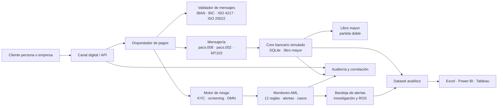

# NovaBank — Instant & Cross-Border Payments + AML Hub

> Portfolio case study by **Franco Tillería Centurión** — Business Analyst (banking) — Asunción, Paraguay
> Fictional case. No real customer, account or confidential data is used.

## Executive Summary (English)

NovaBank is a fictional Paraguayan bank launching instant domestic transfers
(inspired by the BCP's SPI) and cross-border payments over SWIFT/ISO 20022, with
AML monitoring and compliance embedded end to end. This repository documents the
full Business Analysis lifecycle: discovery, process modeling, requirements,
core/middleware design, messaging validation, AML rules, UAT and analytics. It is
a public portfolio built to demonstrate practical BA tools and banking-domain
knowledge on a realistic but entirely synthetic scenario.

The project is complete at artifact level across seven phases. It includes 10
epics and 40 user stories with Gherkin acceptance criteria, 6 BPMN processes, 4
DMN decision tables, a tested SQLite core with double-entry accounting, a FastAPI
`/v1` service, ISO 20022/MT103 validators and simulators, 12 AML monitoring
rules, a synthetic dataset, an 11-sheet Excel workbook, Power BI/Tableau
specifications, and a UAT pack with 65 test cases.

Latest reproducible results (2026-10-29, local Windows environment):

- **204/204 pytest tests passing** across core, messaging, AML and analytics.
- **51/51 automated UAT cases approved**; 6 cases remain pending manual execution
  and 8 are declared as not implemented in the prototype.
- **23/23 SQL control queries OK**; `PRAGMA integrity_check = ok`; 0 foreign-key
  violations.
- **5 open defects** documented, including a critical security gap: the
  prototype API has no authentication or role-based authorization.
- **40/40 user stories traced** to at least one test case.

The automated evidence is real and reproducible. Evidence for Jira, Confluence,
Azure DevOps, Figma/Balsamiq, Power BI, Tableau, Camunda and LinkedIn remains a
manual author task and is tracked in [`docs/EVIDENCIAS.md`](docs/EVIDENCIAS.md).

## El problema

Un banco mediano de Paraguay necesita competir en pagos sin multiplicar el riesgo
operativo y de cumplimiento:

1. Los clientes esperan transferencias locales inmediatas, 24/7, con estado
   visible y sin acudir a una sucursal.
2. Los pagos internacionales exigen mensajería ISO 20022/SWIFT, validación de
   identificadores y control de cumplimiento antes de liberar fondos.
3. El área de cumplimiento necesita KYC, screening, monitoreo transaccional,
   alertas priorizadas, casos investigables y reportes de operaciones
   sospechosas.
4. La operación necesita conciliación contable, trazabilidad y tableros para
   detectar desvíos.
5. El negocio necesita una historia trazable desde el objetivo hasta la prueba,
   no una colección de documentos aislados.

## La solución

El repositorio modela el ciclo completo de un BA end-to-end:

| Fase | Qué resuelve | Entregables principales |
|---|---|---|
| 0 — Preparación | Gobierno del repositorio | `AGENTS.md`, `PLAN.md`, gobernanza |
| 1 — Negocio y procesos | Entender el problema y el contexto regulatorio | BRD, RACI, riesgos, KPIs, glosario, 6 BPMN, 4 DMN, C4/ER/journeys |
| 2 — Requerimientos | Convertir el negocio en backlog trazable | 10 épicas, 40 historias, 16 NFR, 2 sprints, CSV Jira/ADO, kit Confluence, ADR y RAID |
| 3 — Core y middleware | Demostrar contabilidad y API | SQLite con triggers, libro mayor, seed reproducible, 23 consultas, FastAPI `/v1`, OpenAPI |
| 4 — Mensajería | Validar y simular pagos | Catálogo ISO 20022, mapeo MT103↔pacs.008, validador, simuladores local e internacional |
| 5 — AML y compliance | Demostrar KYC, screening y monitoreo | Scoring, 12 reglas SQL, screening difuso, alertas, casos, SLA, ROS ficticios, mapeo SEPRELAD/GAFI |
| 6 — UX y analítica | Mostrar pantallas y capacidad analítica | 10 wireframes, especificaciones UX, 12 CSV, Excel, Power Query, 36 medidas DAX, guía Tableau |
| 7 — QA/UAT y cierre | Verificar y comunicar | Estrategia, plan UAT, 65 casos, defectos, pipelines, README y borradores LinkedIn |

## Arquitectura (vista lógica)



La vista completa de contexto, contenedores, entidades y journeys está en
[`02-procesos/diagramas-sistema.md`](02-procesos/diagramas-sistema.md) y en la
[guía de recreación visual](02-procesos/guia-lucidchart-visio-miro.md).

## Herramientas demostradas

> Estado real del repositorio. No se declara haber operado una herramienta que el
> agente no ejecutó. Las evidencias manuales están en `docs/EVIDENCIAS.md`.

| Capacidad | Herramienta | Artefacto en el repositorio | Estado real |
|---|---|---|---|
| Análisis de negocio | BRD / RACI / riesgos / KPIs | [`01-negocio/`](01-negocio/) | Completado |
| Modelado de procesos | Bizagi / Camunda / Signavio | 6 `.bpmn` en [`02-procesos/bpmn/`](02-procesos/bpmn/) | Validado estructuralmente; importación manual pendiente (EV-004) |
| Modelado de decisiones | DMN (Camunda / Signavio) | 4 `.dmn` en [`02-procesos/dmn/`](02-procesos/dmn/) | Validado estructuralmente; ejecución manual pendiente (EV-004) |
| Diagramación | Lucidchart / Visio / Miro | Mermaid, C4, ER y [guía](02-procesos/guia-lucidchart-visio-miro.md) | Artefactos listos; recreación manual pendiente (EV-005) |
| Gestión de backlog | Jira | [`jira_import.csv`](03-requerimientos/jira_import.csv) + [guía](03-requerimientos/guia-importacion-jira.md) | Artefacto listo; importación manual pendiente (EV-001) |
| Documentación | Confluence | [Kit de espacio](03-requerimientos/confluence/README.md) | Artefacto listo; publicación manual pendiente (EV-002) |
| Gestión de trabajo y CI | Azure DevOps | [CSV de work items](03-requerimientos/ado_import/README.md) + [`azure-pipelines.yml`](08-qa-uat/azure-pipelines.yml) | Artefactos listos; importación y ejecución manual pendientes (EV-003, EV-009) |
| Datos y consultas | SQL (SQLite) | [23 consultas](05-core-middleware/sql/README.md), esquema y reglas AML | Implementado y probado |
| Modelado de requisitos | Historias / Gherkin | [40 historias](03-requerimientos/historias-usuario.md), NFR, DoR/DoD, [trazabilidad](03-requerimientos/matriz-trazabilidad.csv) | Completado |
| Diseño de pantallas | Balsamiq / Figma | [Especificaciones](04-diseno-ux/especificacion-pantallas.md), 10 wireframes y [flujo](04-diseno-ux/flujo-prototipo.md) | Artefactos listos; recreación manual pendiente (EV-006) |
| Excel avanzado | Microsoft Excel | [`NovaBank_analitica.xlsx`](09-analitica/excel/NovaBank_analitica.xlsx) + [documentación](09-analitica/docs/excel.md) | Generado y probado |
| BI — modelado | Power BI | [36 medidas DAX](09-analitica/powerbi/medidas.dax) + [guía](09-analitica/powerbi/README.md) | Artefacto listo; `.pbix` y publicación manual pendientes (EV-007) |
| BI — visualización | Tableau | [Campos calculados](09-analitica/tableau/calculos.md) + [tablero](09-analitica/docs/tablero.md) | Artefacto listo; publicación manual pendiente (EV-008) |
| Mensajería internacional | SWIFT MT / ISO 20022 | [Catálogo](06-mensajeria/docs/catalogo-iso20022.md), [mapeo](06-mensajeria/docs/mapeo-mt103-pacs008.md), validador y simulador | Implementado y probado |
| Pagos instantáneos | SPI-like (simulador) | [Simulador local](06-mensajeria/docs/simuladores.md) | Implementado y probado |
| Core bancario y middleware | SQLite + FastAPI | [Core](05-core-middleware/README.md), [OpenAPI](05-core-middleware/openapi.yaml) | Implementado y probado |
| AML / compliance | KYC, screening, reglas SQL | [README AML](07-aml-compliance/README.md), [reglas](07-aml-compliance/docs/reglas-monitoreo.md), [ROS](07-aml-compliance/docs/ros.md) | Implementado y probado |
| Automatización de pruebas | pytest | [`08-qa-uat/`](08-qa-uat/README.md) y suites de fases 3 a 7 | Implementado; 204/204 |
| UAT y evidencia | Azure Test Plans / Excel | [65 casos](08-qa-uat/casos-prueba.csv), [matriz](08-qa-uat/matriz-ejecucion.xlsx) | Automatización ejecutada; UAT manual pendiente |
| Integración continua | GitHub Actions | [`.github/workflows/ci.yml`](.github/workflows/ci.yml) | Workflow listo; run manual pendiente (EV-010) |
| Difusión | LinkedIn | [`docs/linkedin.md`](docs/linkedin.md) | Borradores listos; publicación pendiente (EV-011) |

## Cómo ejecutar el proyecto

Requisitos: Python 3.12+ (el entorno local verificado usa 3.15), PowerShell 5.1
en Windows o bash en Linux/macOS.

```powershell
# 1. Crear y activar el entorno
python -m venv .venv
.\.venv\Scripts\Activate.ps1
# Si PowerShell bloquea scripts:
# Set-ExecutionPolicy -Scope Process -ExecutionPolicy Bypass

# 2. Instalar dependencias
pip install -r requirements.txt

# 3. Generar la base sintética (semilla fija 20261027)
python 05-core-middleware\scripts\seed.py --db 05-core-middleware\db\novabank.db

# 4. Ejecutar la suite completa
python -m pytest -q

# 5. Ejecutar UAT, controles SQL y generar la matriz Excel
python 08-qa-uat\scripts\run_uat.py

# 6. API local (opcional)
uvicorn app.main:app --reload --app-dir 05-core-middleware
```

Artefactos que se generan:

- `05-core-middleware/db/novabank.db` (ignorada por git).
- `08-qa-uat/resultados/junit-uat.xml`, `resultados-uat.json`, `resultados-uat.csv`
  y `sql-controls.json`.
- `08-qa-uat/matriz-ejecucion.xlsx`.
- `09-analitica/data/*.csv` y `09-analitica/excel/NovaBank_analitica.xlsx`.

## Resultados clave (métricas reales)

### Dataset y contabilidad

| Métrica | Resultado |
|---|---|
| Clientes sintéticos | 500 |
| Cuentas | 800 |
| Movimientos | 49.582 |
| Operaciones sospechosas etiquetadas | 341 |
| Líneas de libro mayor | 104.966 |
| Asientos | 52.084 |
| Diferencias de conciliación | 0 |
| Desbalance global PYG/USD | 0 |
| `PRAGMA integrity_check` | `ok` |
| Violaciones de clave foránea | 0 |

### Mensajería

| Métrica | Resultado |
|---|---|
| Tipos de mensaje catalogados | 4 (`pacs.008`, `pacs.002`, `pain.001`, `camt.053`) |
| Filas de mapeo MT103↔pacs.008 | 14 |
| Ejemplos validados | 5 XML + 1 MT103 |
| Validación | Estructural y de negocio, no contra XSD oficiales (S-056) |

### AML

| Métrica | Resultado |
|---|---|
| Reglas SQL | 12 (R01–R12) |
| Transacciones alertadas en la evaluación | 494 |
| Verdaderos positivos etiquetados | 341 |
| Falsos positivos etiquetados | 3 |
| Alertas sin etiqueta | 150 |
| Recall sobre sospechosas | 100 % |
| Precisión sobre etiquetadas | 99,13 % |
| Precisión conservadora | 69,03 % |
| Alertas deduplicadas (snapshot Fase 5) | 775 |
| Alertas en el corte analítico (Fase 6) | 377 |

> La diferencia entre 775 y 377 está documentada como **DEF-004 / P-018**: son
> cortes distintos de la misma base, no un resultado contradictorio oculto.

### Analítica y UX

| Métrica | Resultado |
|---|---|
| CSV analíticos | 12 |
| Pagos locales en el dataset | 10.820 |
| Casos analíticos | 59 |
| Medidas DAX | 36 |
| Scripts Power Query | 14 |
| Hojas del workbook Excel | 11 |
| Wireframes SVG | 10 |

### QA/UAT

| Métrica | Resultado |
|---|---|
| Casos de prueba | 65 |
| Positivos / negativos / límites | 25 / 32 / 8 |
| Casos automatizados aprobados | 51/51 (100 %) |
| Casos manuales pendientes | 6 |
| Casos no implementados | 8 |
| Historias cubiertas | 40/40 |
| Pruebas pytest | 204/204 |
| Consultas SQL de control | 23/23 |
| Defectos abiertos | 5 (1 crítica, 2 altas, 2 medias) |

## Qué demuestra y qué no demuestra

**Demuestra:**

- Capacidad de traducir un problema bancario en procesos, requerimientos,
  criterios de aceptación, modelo de datos, API, mensajes, reglas AML, UAT y
  tableros.
- Rigor contable: partida doble, inmutabilidad, conciliación y controles SQL.
- Criterio de mensajería: validación de IBAN, BIC, ISO 4217, importes, estados y
  mapeo MT103↔pacs.008.
- Criterio AML: KYC, screening difuso, reglas, alertas, casos, SLA y ROS.
- Honestidad de alcance: separa lo automatizado, lo manual y lo no implementado.

**No demuestra:**

- Conectividad real con SPI del BCP, SWIFT, corresponsales o cámaras.
- Certificación ISO 20022 contra XSD oficiales.
- Autenticación, autorización, cifrado, pruebas de penetración o cumplimiento
  PCI.
- Rendimiento, carga, alta disponibilidad, RTO/RPO o recuperación ante desastres.
- Un front-end productivo, accesibilidad real o pruebas con usuarios reales.
- Presentación efectiva de un ROS ante una autoridad.
- Uso operado de Jira, Confluence, Azure DevOps, Figma, Power BI, Tableau,
  Camunda, Bizagi, Signavio, Lucidchart, Visio o Miro.

## Aprendizajes

1. **La reproducibilidad vale más que el volumen.** Una semilla fija y SQLite
   permitieron ejecutar 204 pruebas en menos de 20 segundos y repetir cualquier
   resultado.
2. **La trazabilidad expone huecos.** Al asignar un caso a cada una de las 40
   historias aparecieron 8 funcionalidades especificadas pero no implementadas.
   Eso es información útil, no un fracaso que deba ocultarse.
3. **Los datos sintéticos habilitan AML sin PII, pero limitan la evaluación.**
   Con solo ~1 % de muestra normal, la precisión conservadora baja a 69,03 %; la
   métrica sobre etiquetadas (99,13 %) debe leerse con esa advertencia.
4. **La contabilidad a nivel de base es una red de seguridad.** Los triggers de
   partida doble e inmutabilidad detectan errores que una prueba de API podría
   dejar pasar.
5. **Simular no es integrar.** Los simuladores demuestran criterio funcional,
   pero no reemplazan una certificación ni una conexión real.
6. **Un artefacto listo para importar no es una herramienta operada.** El
   repositorio separa explícitamente ambas cosas para no inflar el currículum.
7. **La UAT manual sigue siendo necesaria.** Seis casos dependen de pantallas,
   flujos de aprobación o herramientas que el prototipo no tiene.
8. **La seguridad no es un detalle de fase 7.** La ausencia de autenticación es
   el defecto crítico que impide presentar el prototipo como piloto productivo.

## Estado del proyecto

| Fase | Estado |
|---|---|
| 0 — Preparación del repositorio | Completada |
| 1 — Negocio y procesos | Completada en artefactos; EV-004 y EV-005 pendientes |
| 2 — Requerimientos | Completada en artefactos; EV-001 a EV-003 pendientes |
| 3 — Core bancario y middleware | Completada y probada |
| 4 — Mensajería | Completada y probada |
| 5 — AML y compliance | Completada y probada |
| 6 — UX y analítica | Completada en artefactos; EV-006 a EV-008 pendientes |
| 7 — QA/UAT y cierre | Completada en automatización y artefactos; EV-009 a EV-011 pendientes |

## Estructura del repositorio

```text
nova-payments-aml/
├─ 01-negocio/           # BRD, stakeholders, riesgos, glosario, KPIs
├─ 02-procesos/          # BPMN, DMN, AS-IS/TO-BE, diagramas
├─ 03-requerimientos/    # épicas, historias, CSV Jira/ADO, Confluence, trazabilidad
├─ 04-diseno-ux/         # wireframes, especificaciones de pantalla, prototipo
├─ 05-core-middleware/   # modelo SQLite, libro mayor, API, datos sintéticos, tests
├─ 06-mensajeria/        # ISO 20022, MT103, validador, simulador instantáneo
├─ 07-aml-compliance/    # KYC, reglas SQL, screening, alertas, ROS, normativa
├─ 08-qa-uat/            # estrategia, casos UAT, pipelines, evidencias
├─ 09-analitica/         # datasets, Excel, Power BI (DAX), Tableau
├─ docs/                 # gobernanza: supuestos, pendientes, fuentes, evidencias
├─ .github/workflows/    # CI de GitHub Actions
├─ AGENTS.md             # reglas operativas para agentes y colaboradores
├─ PLAN.md               # hoja de ruta por fases
├─ requirements.txt      # dependencias de Python
├─ .env.example          # variables de entorno (sin secretos)
└─ .gitignore
```

## Gobierno del proyecto

| Documento | Uso |
|---|---|
| [`PLAN.md`](PLAN.md) | Fases, tareas y criterios de cierre |
| [`AGENTS.md`](AGENTS.md) | Reglas de trabajo, contexto y convenciones |
| [`docs/SUPUESTOS.md`](docs/SUPUESTOS.md) | Decisiones y supuestos registrados |
| [`docs/PENDIENTES.md`](docs/PENDIENTES.md) | Bloqueos y tareas que requieren acción manual |
| [`docs/FUENTES.md`](docs/FUENTES.md) | Fuentes oficiales verificadas y su uso |
| [`docs/EVIDENCIAS.md`](docs/EVIDENCIAS.md) | Pasos manuales, capturas y enlaces de herramientas |
| [`08-qa-uat/README.md`](08-qa-uat/README.md) | Estrategia, casos, resultados y pipelines |
| [`docs/linkedin.md`](docs/linkedin.md) | Textos para Destacados y borradores de posts |

## Aviso de ficción

NovaBank, sus clientes, cuentas, BIC e IBAN son inventados. Los formatos son
válidos a título ilustrativo, pero no corresponden a entidades reales. Las
referencias a BCP, SWIFT, GAFI, SEPRELAD e ISO 20022 son públicas y se citan como
contexto normativo/técnico; el repositorio no representa a ninguna de esas
entidades ni utiliza información confidencial.

## Autor

**Franco Tillería Centurión** — Analista Funcional / Business Analyst
LinkedIn: _pendiente de enlace público_ (ver P-004 en `docs/PENDIENTES.md`).
