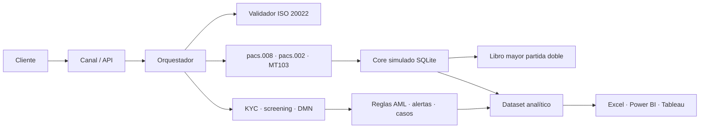

# Case study — NovaBank Instant & Cross-Border Payments + AML Hub

**Autor:** Franco Tillería Centurión — Analista Funcional / Business Analyst
**Rol en el caso:** BA end-to-end (descubrimiento, procesos, requerimientos,
diseño funcional, mensajería, AML, analítica y UAT).
**Naturaleza:** caso 100 % ficticio; datos sintéticos reproducibles.

## 1. Problema

Un banco mediano de Paraguay necesita lanzar pagos instantáneos locales y pagos
internacionales sin multiplicar el riesgo operativo y de cumplimiento. El banco
enfrenta cinco tensiones simultáneas:

- Los clientes esperan transferencias inmediatas 24/7 y visibilidad de estado.
- Los pagos internacionales exigen ISO 20022/SWIFT y validación de identificadores.
- Cumplimiento necesita KYC, screening, monitoreo, alertas priorizadas, casos y ROS.
- Operaciones necesita contabilidad conciliada, trazabilidad y tableros.
- El negocio necesita trazabilidad de objetivo → requerimiento → prueba.

El proyecto debía demostrar criterio de negocio y de control, no solo documentos.

## 2. Solución

Se construyó un portafolio end-to-end en ocho fases:

1. **Negocio y procesos:** BRD, stakeholders y RACI, riesgos, KPIs, glosario y
   contexto regulatorio con fuentes oficiales.
2. **Procesos:** 6 BPMN (onboarding, pago local, pago internacional, alertas,
   investigación/ROS y AS-IS/TO-BE) y 4 DMN (scoring, ruteo, prioridad y límites).
3. **Requerimientos:** 10 épicas, 40 historias con Gherkin, 198 story points,
   16 NFR, DoR/DoD, CSV Jira y Azure DevOps, kit Confluence con 6 ADR y RAID log.
4. **Core y middleware:** SQLite con libro mayor de partida doble, 15 triggers,
   seed reproducible con semilla fija, API FastAPI `/v1` con idempotencia,
   OpenAPI y 23 consultas SQL.
5. **Mensajería:** catálogo ISO 20022 (`pacs.008`, `pacs.002`, `pain.001`,
   `camt.053`), mapeo MT103↔pacs.008, validador de IBAN/BIC/ISO 4217/importes y
   simuladores local e internacional.
6. **AML:** scoring KYC, 12 reglas SQL, screening difuso con listas ficticias,
   alertas deduplicadas, casos con SLA, dos ROS ficticios y mapeo SEPRELAD/GAFI.
7. **UX y analítica:** 10 wireframes, 12 CSV, workbook Excel de 11 hojas,
   36 medidas DAX, Power Query y especificación Tableau.
8. **QA/UAT y auditoría:** 65 casos, 51 automatizados, 5 defectos, pipelines,
   auditoría de verdad y prueba desde cero.

## 3. Arquitectura

Decisiones clave:

- **Libro mayor como fuente de verdad contable**, con saldo operativo conciliado.
- **Idempotencia obligatoria** en la API para evitar duplicados.
- **Validación estructural y de negocio** de mensajes, sin declarar conformidad XSD.
- **Reglas AML en SQL parametrizado**, calibradas sobre datos sintéticos.
- **Simuladores deterministas** en lugar de integraciones reales.

## 4. Resultados reales medidos

Todos los números fueron reproducidos en un clon limpio el 2026-10-29:

| Dimensión | Resultado |
|---|---|
| Pruebas automatizadas | **204/204** aprobadas |
| UAT automatizada | **51/51** aprobadas; 6 manuales y 8 no implementadas |
| Controles SQL | **23/23**; `integrity_check=ok`; 0 FK |
| Dataset | 500 clientes, 800 cuentas, 49.582 movimientos |
| Contabilidad | 104.966 líneas, 52.084 asientos, 0 descuadres |
| AML | 494 alertadas, 341 TP, 3 FP, 150 sin etiqueta |
| Calidad AML | Recall 100 %; precisión 99,13 % sobre etiquetadas |
| Analítica | 12 CSV, 377 alertas reproducibles, 59 casos, 11 hojas Excel |
| Trazabilidad | 40/40 historias con al menos un caso |
| Portafolio visual | Marca, 6 gráficos, arquitectura/secuencias/BPMN, dashboard, UX, demo GIF, carrusel LinkedIn, GitHub Pages |

Lectura honesta: la precisión conservadora es **69,03 %** porque la muestra
normal es solo ~1 % del dataset. El 99,13 % aplica únicamente a las transacciones
etiquetadas.

## 5. Herramientas

| Usada realmente por el agente | Entregada como artefacto; requiere ejecución manual |
|---|---|
| Python, SQLite, FastAPI, pytest, openpyxl, PyYAML, Playwright, Pillow, Matplotlib, img2pdf, Mermaid, bpmn-js | Jira, Confluence, Azure DevOps, Bizagi/Camunda/Signavio, Lucidchart/Visio/Miro, Balsamiq/Figma, Power BI, Tableau, Excel (workbook generado, revisión visual manual) |

Los artefactos manuales están listos para importar o replicar; las capturas y
enlaces quedan pendientes en `docs/EVIDENCIAS.md`. No se declara haber operado
esas herramientas.

## 6. Límites y aprendizajes

- No hay conectividad real con SPI, SWIFT, corresponsales ni cámaras.
- No hay certificación ISO 20022 contra XSD oficiales.
- La API no tiene autenticación ni autorización (DEF-003, crítica).
- No se probó rendimiento, alta disponibilidad, RTO/RPO ni recuperación.
- No se presentó ningún ROS ante una autoridad.
- La UAT manual y las capturas de herramientas externas siguen pendientes.

El principal aprendizaje: **la trazabilidad y la reproducibilidad valen más que
el volumen**. Un repositorio que distingue lo automatizado, lo manual y lo no
implementado es más creíble que uno que declara haber hecho todo.
